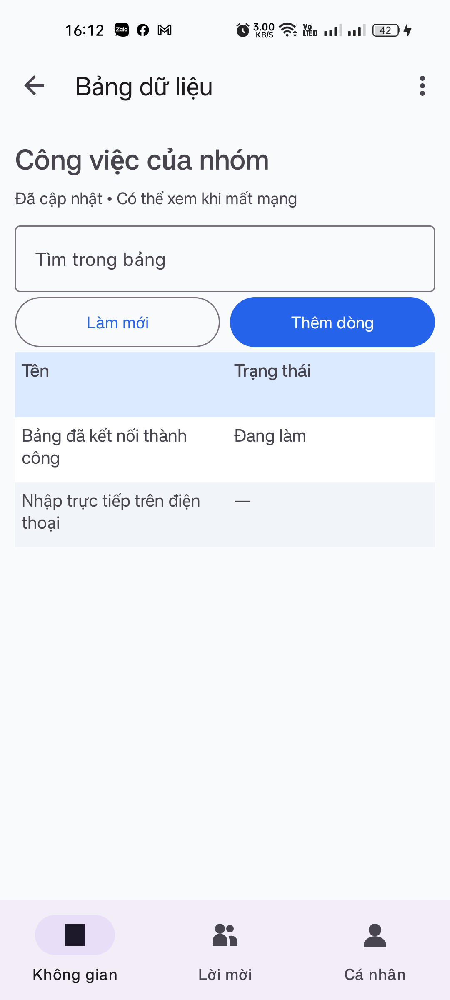

# 3DDK
Hướng dẫn sử dụng & kiểm thử

Dành cho thành viên nhóm • Bản 0.2.0-preview • Ngày 04/10/2026

Mục tiêu: tự tạo một bảng, nhập dữ liệu, mời người khác cùng làm và kiểm tra dữ liệu có được giữ đúng hay không.

## Chuẩn bị trước khi bắt đầu

1. Dùng điện thoại Android 7.0 trở lên và file 3DDK-v0.2.0-test.apk do nhóm cung cấp.

2. Chuẩn bị hai điện thoại, hai email có thể nhận thư. Để thử đầy đủ quyền chỉ xem, dùng thêm tài khoản thứ ba.

3. Bật mạng khi đăng ký và tải bảng lần đầu. Dùng dữ liệu thử, ví dụ tên việc hoặc số giờ dự kiến.

4. Đặt tên không gian TEST - tên bạn - ngày thử để tránh nhầm với dữ liệu của người khác.

## Cách đọc tài liệu

Mục 1–6 hướng dẫn sử dụng. Mục 7–9 là các bài kiểm tra và cách báo lỗi. Ảnh ở mục 3 là ảnh chụp thật từ điện thoại; các khung và mũi tên khác là sơ đồ minh họa dựa trên giao diện hiện có.

Đăng ký Xác minh email → Tạo không gian Tạo bảng → Nhập dữ liệu Mời cùng làm → Thử lỗi Ghi kết quả

Đây là bản dùng thử dạng bảng tùy chỉnh. Chưa có đầy đủ chức năng của Teable. Những bài trong tài liệu là yêu cầu kiểm tra, không phải tất cả đều đã được xác nhận đạt.

# 1. Cài ứng dụng và tạo tài khoản

1. Mở file 3DDK-v0.2.0-test.apk trên điện thoại. Nếu Android hỏi quyền cài từ ứng dụng đang mở file, cho phép ứng dụng đó rồi quay lại bấm Cài đặt. Tên mục có thể khác tùy hãng máy.

2. Nếu đã có bản debug cũ, cài cập nhật để giữ dữ liệu. Nếu báo không cài được hoặc chữ ký không khớp, chụp lỗi gửi nhóm; đừng gỡ ứng dụng khi còn nháp chưa gửi.

3. Mở 3DDK Tasks. Nhập Email và Mật khẩu (ít nhất 6 ký tự), bấm Tạo tài khoản.

4. Mở hộp thư của email vừa nhập, kiểm tra cả mục thư rác và mở liên kết xác minh.

5. Quay lại ứng dụng, bấm Tôi đã xác minh. Khi thành công, bạn vào mục Không gian. Bạn không cần lời mời để tự tạo không gian của mình.

**Hình minh họa:** Minh họa: đăng ký → xác minh
Email: email của bạn
Mật khẩu: tự chọn, không gửi cho nhóm
[ Tạo tài khoản ] → mở thư xác minh
[ Tôi đã xác minh ] → vào Không gian

## Nếu đã có tài khoản

Nhập email và mật khẩu rồi bấm Đăng nhập. Nếu quên mật khẩu, điền email trước, bấm Quên mật khẩu và làm theo thư nhận được. Gửi lại email dùng khi đang ở màn hình xác minh mà chưa nhận được thư.

Kết quả cần thấy: màn hình “Không gian của bạn”. Nếu ứng dụng còn báo phải được nhóm trưởng mời hoặc chưa kết nối Firebase/Supabase, kiểm tra lại file APK đang cài với nhóm phát triển.

# 2. Tạo nơi làm việc và bảng đầu tiên

Không gian là nơi chia sẻ với mọi người. Cơ sở dữ liệu là một nhóm bảng. Bảng chứa các dòng; mỗi cột quy định loại thông tin cần nhập.

Không gian TEST - An - 0410 → Cơ sở dữ liệu Dự án môn học → Bảng Công việc nhóm → Dòng Một công việc

1. Chọn Không gian ở thanh dưới cùng → Tạo không gian.

2. Nhập TEST - tên bạn - ngày thử, bấm Tạo. Chờ danh sách cập nhật rồi chạm vào không gian vừa tạo.

3. Bấm Tạo cơ sở dữ liệu → nhập Dự án môn học → Tạo. Chạm vào mục vừa tạo.

4. Bấm Tạo bảng → nhập Công việc nhóm → Tạo. Chạm vào bảng vừa tạo để mở.

5. Bảng mới có sẵn cột Tên. Ở góc trên bên phải, mở menu ba chấm → Thêm cột.

## Tạo các cột mẫu để cả nhóm thử giống nhau

| Tên cột | Kiểu chọn | Nội dung cần điền |
| --- | --- | --- |
| Trạng thái | Lựa chọn | Chưa làm, Đang làm, Xong |
| Số giờ | Số | Không cần khai báo lựa chọn |
| Ngày dự kiến | Ngày (YYYY-MM-DD) | Nhập ngày khi thêm dòng |
| Hoàn thành | Đánh dấu | Dùng ô tích khi thêm dòng |

Mỗi lần thêm cột: nhập Tên cột, chọn kiểu rồi bấm Thêm. Với kiểu Lựa chọn, nhập các giá trị cách nhau bằng dấu phẩy. Chỉ chủ không gian có menu Thêm cột. Tên không gian/cơ sở dữ liệu/bảng/cột dài từ 1 đến 100 ký tự.

Kết quả cần thấy: bảng có cột Tên và các cột vừa thêm. Vuốt ngang trong vùng bảng để xem những cột nằm ngoài màn hình.

# 3. Nhận biết các nút trên bảng

Ảnh chụp thật: bảng mẫu đã tạo trên điện thoại, có hai dòng dữ liệu. Tài khoản mới sẽ không tự có bảng này; hãy tạo bảng theo mục 2 hoặc nhận lời mời.

| Vị trí trong ảnh | Thao tác |
| --- | --- |
| Ba chấm góc trên phải | Thêm cột, dành cho chủ không gian. |
| Tìm trong bảng | Gõ nội dung muốn tìm; xóa từ khóa để xem lại tất cả. |
| Làm mới | Lấy dữ liệu mới, nhất là sau khi người khác vừa sửa. |
| Thêm dòng / một dòng có sẵn | Tạo dòng mới / mở dòng để xem hoặc sửa. |
| Vùng các ô trong bảng | Vuốt ngang xem thêm cột; cuộn dọc xem thêm dòng. |

# 4. Nhập, sửa và tìm dữ liệu

1. Trong bảng, bấm Thêm dòng.

2. Điền Tên: Thiết kế màn hình đăng nhập. Chọn Trạng thái: Đang làm. Nhập Số giờ: 2.5 và Ngày dự kiến: 2026-10-10. Chưa tích Hoàn thành.

3. Chờ dòng trạng thái “Đã lưu nháp trên máy • Chưa gửi”. Đây mới là bản lưu trên điện thoại.

4. Bấm Lưu lên bảng. Khi lưu thành công, ứng dụng trở về bảng. Nếu chưa thấy dòng, bấm Làm mới.

5. Chạm dòng vừa tạo → đổi Trạng thái thành Xong, tích Hoàn thành → Lưu lên bảng.

6. Gõ “Thiết kế” vào Tìm trong bảng. Kiểm tra dòng vừa nhập xuất hiện, sau đó xóa từ khóa để xem lại toàn bảng.

**Hình minh họa:** Minh họa: nội dung một dòng
Tên: Thiết kế màn hình đăng nhập
Trạng thái: Đang làm     |     Số giờ: 2.5
Ngày dự kiến: 2026-10-10     |     Hoàn thành: chưa tích
[ Lưu lên bảng ] → gửi dữ liệu cho mọi người

## Quy tắc nhập cần nhớ

Ngày phải theo thứ tự năm-tháng-ngày, ví dụ 2026-10-10. Số thập phân dùng dấu chấm, ví dụ 2.5. Cột Lựa chọn chỉ nhận các mục đã khai báo; dấu “—” là chưa chọn. Không dùng dòng trạng thái lưu nháp để kết luận dữ liệu đã lên bảng.

## Thử dữ liệu không hợp lệ

Nhập 2026-02-30 vào cột ngày rồi bấm Lưu lên bảng. Mong đợi: ứng dụng báo giá trị chưa đúng kiểu dữ liệu, giữ nội dung để sửa. Đổi thành ngày có thật rồi lưu lại. Ghi Không đạt nếu ngày sai vẫn được lưu thành công.

# 5. Mời thành viên cùng sử dụng

Người tạo không gian là chủ không gian đó. Mỗi người vẫn có thể tạo không gian riêng; không có một nhóm trưởng duy nhất kiểm soát toàn bộ ứng dụng.

| Vai trò | Được làm gì trong bản này |
| --- | --- |
| Chủ không gian | Tạo cơ sở dữ liệu/bảng, thêm cột, thêm/sửa dòng, mời người. |
| Có thể chỉnh sửa | Tạo cơ sở dữ liệu/bảng, thêm và sửa dòng; không thêm cột hoặc mời người. |
| Chỉ xem | Mở và đọc dữ liệu; không tạo hoặc sửa dữ liệu. |

1. Máy A (chủ): quay lại màn hình bên trong không gian, nơi có nút Tạo cơ sở dữ liệu.

2. Mở menu ba chấm → Mời thành viên. Nhập đúng email tài khoản trên máy B, chọn Có thể chỉnh sửa → Mời.

3. Máy B: đăng nhập bằng đúng email đã mời và hoàn tất xác minh. Chọn Lời mời ở thanh dưới → Làm mới.

4. Chạm lời mời → Tham gia. Chọn Không gian → Làm mới → mở không gian được chia sẻ, rồi mở cơ sở dữ liệu và bảng.

5. Máy B thêm dòng “Dữ liệu từ máy B” rồi Lưu lên bảng. Máy A bấm Làm mới và kiểm tra có dòng đó.

6. Máy A sửa dòng này thành “Máy A đã kiểm tra”. Máy B bấm Làm mới để xem thay đổi.

Máy A Mời đúng email → Máy B Lời mời → Tham gia → Máy B Lưu một dòng → Máy A Làm mới để xem

Lời mời nằm trong ứng dụng, chưa gửi email thông báo tự động. Lời mời có hiệu lực 7 ngày. Bản này chưa tự cập nhật ngay khi người khác sửa; dùng Làm mới.

## Thử quyền chỉ xem

Mời tài khoản C với quyền Chỉ xem. Sau khi tham gia, C phải xem được bảng nhưng không thể lưu thay đổi; không thấy nút tạo dữ liệu. Dùng tài khoản khác cho bài này vì bản hiện tại chưa có màn hình đổi quyền thành viên đã tham gia.

# 6. Mất mạng, nháp và sửa cùng lúc

## Bài thử mất mạng

1. Khi còn mạng, mở bảng và chạm một dòng để dữ liệu được tải về máy. Quay lại bảng.

2. Bật chế độ máy bay; kiểm tra Wi-Fi cũng đã tắt. Mở lại bảng đã tải: dữ liệu cũ cần còn đọc được.

3. Chạm dòng → thêm “ - nháp offline” vào Tên. Chờ thông báo Đã lưu nháp trên máy.

4. Đóng ứng dụng khỏi danh sách ứng dụng gần đây rồi mở lại. Vào đúng bảng, đúng dòng: nội dung nháp cần còn. Với dòng mới, bấm Thêm dòng trong đúng bảng để mở lại nháp.

5. Thử Lưu lên bảng khi chưa có mạng. Mong đợi: báo lỗi, nội dung đang soạn vẫn còn.

6. Bật mạng trở lại. Kiểm tra nội dung rồi tự bấm Lưu lên bảng. Máy khác bấm Làm mới để xác nhận.

Lần đầu chưa tải dữ liệu thì không thể mở bảng khi mất mạng. Nháp không tự gửi khi mạng trở lại. Không đăng xuất hoặc xóa dữ liệu ứng dụng trong bài thử giữ nháp.

## Bài thử hai người sửa cùng một dòng

1. Hai máy cùng mở một dòng trước khi ai bấm lưu. Máy A sửa Tên và lưu trước.

2. Máy B sửa theo nội dung cũ rồi bấm Lưu lên bảng. Mong đợi: cảnh báo dòng đã được sửa trên thiết bị khác, không âm thầm ghi đè.

3. Máy B giữ nháp. Đối chiếu dữ liệu máy A vừa lưu với người thử trên máy A trước khi quyết định thay thế.

4. Nếu muốn lưu nội dung của B, bấm Xem phiên bản mới → đọc cảnh báo → Tải phiên bản mới. Kiểm tra mọi ô trong nháp, điều chỉnh rồi mới bấm Lưu lên bảng.

Lưu ý: nút Xem phiên bản mới hiện chưa có màn hình so sánh hai bản. Thao tác này nhận phiên bản mới nhưng giữ nội dung nháp; lần lưu tiếp có thể thay thế nội dung người khác vừa nhập. Chỉ thử trên dòng dữ liệu thử.

# 7. Hồ sơ, đăng xuất và lỗi thường gặp

## Hồ sơ cá nhân

Chọn Cá nhân → sửa Tên hiển thị → Chọn avatar nếu muốn → Lưu hồ sơ. Mở lại mục Cá nhân để kiểm tra. Khi đăng xuất, ứng dụng xóa dữ liệu đã tải và nháp trên máy; dữ liệu đã lưu thành công lên bảng vẫn nằm trên hệ thống.

Để thử cảnh báo đăng xuất: tạo một nháp thử, vào Cá nhân → Đăng xuất. Kiểm tra lời cảnh báo có nhắc nháp; bấm Ở lại để giữ nháp. Chỉ xác nhận Đăng xuất khi đã đồng ý bỏ nháp thử đó.

| Hiện tượng | Cách xử lý |
| --- | --- |
| Chưa nhận thư xác minh | Kiểm tra email đã nhập và thư rác. Bấm Gửi lại email, chờ thư rồi quay lại Tôi đã xác minh. |
| Không thấy lời mời | Đối chiếu đúng email đăng nhập; bấm Làm mới trong Lời mời. Nhờ chủ kiểm tra lời mời còn hạn. |
| Không thấy dữ liệu người khác vừa nhập | Kiểm tra đang mở đúng không gian/bảng và có mạng, sau đó Làm mới. |
| Không thấy Thêm cột | Chỉ chủ không gian có nút này; mở menu trong bảng. |
| Lưu bị lỗi | Giữ màn hình/nháp, kiểm tra ngày và số, kiểm tra mạng; ghi nguyên thông báo lỗi. |
| Thông báo chưa được mời / chưa cấu hình | Có thể đang cài bản cũ hoặc chưa cấu hình. Gửi ảnh cho người phụ trách, kiểm tra lại APK v0.2.0. |
| Cài APK thất bại | Gửi ảnh lỗi và phiên bản đang dùng. Không gỡ bản cũ khi còn nháp cần giữ. |

## Những chức năng chưa có trong bản dùng thử

Chưa có Kanban/lịch, công thức, liên kết giữa bảng, đính kèm file, nhập/xuất bảng, cập nhật tức thời hoặc tự động hóa. Chưa có màn hình đổi tên/sắp xếp cột, đổi quyền thành viên và xóa dòng. Thông báo đẩy cho bảng mới chưa nghiệm thu; mục Cài đặt thông báo chưa chứng minh rằng bảng sẽ gửi thông báo.

# 8. Phiếu kiểm thử của nhóm

Người thử: __________________  Ngày: __________  Máy / Android: __________________

APK: 0.2.0-preview. Điền Đạt / Không đạt / Chưa thử vào file CSV đi kèm. Chỉ đánh dấu Đạt sau khi tự thực hiện; gửi kèm ảnh nếu khác kết quả mong đợi.

| Mã | Bài thử | Kết quả mong đợi |
| --- | --- | --- |
| T01 | Đăng ký và xác minh | Tài khoản mới vào Không gian, tự tạo được không gian. |
| T02 | Tạo cấu trúc bảng | Có không gian, cơ sở dữ liệu, bảng và các cột đúng kiểu. |
| T03 | Thêm và sửa dòng | Lưu xong, làm mới vẫn thấy đúng nội dung. |
| T04 | Ngày sai | 2026-02-30 bị từ chối; nội dung đang nhập không mất. |
| T05 | Tìm và cuộn ngang | Tìm thấy dòng phù hợp; xem được cột ngoài màn hình. |
| T06 | Mời người chỉnh sửa | Máy B tham gia, thêm/sửa; máy A làm mới thấy thay đổi. |
| T07 | Quyền chỉ xem | Tài khoản C đọc được, không tạo/sửa/lưu dữ liệu. |
| T08 | Tài khoản chưa được mời | Tài khoản D không thấy không gian TEST của A trong danh sách. |
| T09 | Đọc khi mất mạng | Bảng đã tải vẫn xem được khi tắt mạng. |
| T10 | Giữ nháp sau đóng app | Nháp còn khi mở lại đúng bảng/dòng. |
| T11 | Gửi nháp sau có mạng | Chủ động lưu thành công; máy khác nhìn thấy. |
| T12 | Sửa cùng lúc | Máy B báo xung đột; giữ nháp; không tự ghi đè máy A. |
| T13 | Bấm lưu liên tiếp | Một thao tác thêm dòng không tạo nhiều dòng trùng. |
| T14 | Hồ sơ và đăng xuất | Hồ sơ lưu được; đăng xuất cảnh báo nháp; đổi tài khoản không thấy cache cũ. |
| T15 | Màn hình và cỡ chữ | Xoay máy/tăng chữ vẫn đọc, cuộn và bấm nút được. |

T08 chỉ kiểm tra việc hiển thị trên ứng dụng; không thay thế bài kiểm tra quyền truy cập ở máy chủ. Các bài nhiều tài khoản, mất mạng thực tế và sửa đồng thời cần nhóm chạy và ghi lại kết quả.

# 9. Gửi lỗi để sửa nhanh

## Mẫu báo lỗi: sao chép và điền

Mã bài thử: T__

Tên lỗi: ví dụ Mở lại dòng thì mất phần vừa gõ

Máy / phiên bản Android / bản ứng dụng: ...

Tên không gian và bảng thử: ...

Vai trò: Chủ không gian / Có thể chỉnh sửa / Chỉ xem

Mạng: Wi-Fi / dữ liệu di động / tắt mạng

Các bước đã làm: 1… 2… 3…

Mong đợi: ...

Thực tế: ... (chép nguyên thông báo nếu có)

Có lặp lại không: ... lần / ... lần thử

Ảnh hoặc video màn hình: đính kèm; che thông tin riêng trước khi chia sẻ

## Ưu tiên báo ngay

Mất nháp hoặc mất dữ liệu; nhìn thấy dữ liệu của người chưa chia sẻ; người chỉ xem vẫn sửa được; ứng dụng đóng đột ngột; đăng nhập hoặc lưu dữ liệu bị chặn. Lỗi chữ lệch, khoảng cách hoặc màu sắc có thể ghi sau.

## Kết quả đã có trước buổi thử

Ngày 04/10/2026: đã chạy kiểm tra trên một điện thoại thật cho luồng tạo bảng/cột/dòng, sửa dữ liệu, hiển thị bảng; nhập qua giao diện, giữ nháp khi màn hình được tạo lại và gửi thành công. Chưa dùng kết quả này để kết luận đã đạt mọi bài hai máy hoặc chế độ máy bay trong phiếu.

Kết thúc buổi thử: gửi phiếu CSV đã điền, ảnh/video lỗi và tên bản APK. Giữ nguyên dữ liệu lỗi để người phụ trách tái hiện; đừng ghi mật khẩu, mã xác minh hay khóa cấu hình vào phiếu.
