# Milestone 1: Sitemap và User Flow

Nhóm thực hiện: **Nhóm 3**.

Đề tài: **Ứng dụng quản lí công việc 3DDK**. Đối chiếu mã `d044254`, ngày 20/10/2026; bổ sung thiết kế đăng nhập Google theo yêu cầu của nhóm, triển khai sau.

File PDF: [NHOM 3_MILESTONE 1_3DDK.pdf](NHOM%203_MILESTONE%201_3DDK.pdf).

Bản Word có thể sửa: [NHOM 3_MILESTONE 1_3DDK.docx](NHOM%203_MILESTONE%201_3DDK.docx).

## Chỉnh sửa bản Word

Mở DOCX bằng Microsoft Word trên máy tính. Bấm vào chữ trong khối để sửa nội dung; chọn viền khối để kéo hoặc đổi kích thước. Mũi tên là đường vẽ riêng, có thể chọn và kéo hai đầu; khi di chuyển khối cần căn lại đường nối. Nếu khó chọn đối tượng, mở **Home → Select → Selection Pane** (Ngăn lựa chọn).

Chữ trong hình thoi là ô chữ riêng; chọn cả hình và chữ khi di chuyển. Nếu thêm đoạn dài, tăng chiều cao ô chữ để nội dung không bị khuất.

Trang bìa, đoạn văn, khối sơ đồ và bảng so sánh đều là đối tượng Word chỉnh sửa được; logo trường giữ dạng ảnh. Bảng so sánh dùng ô, hàng và cột Word. Tài liệu có một trang dọc, bốn trang ngang và chữ Times New Roman cỡ 13. Sau khi chỉnh, dùng **Save As → PDF** để tạo bản nộp mới; DOCX không tự cập nhật PDF đã có. Bố cục có thể thay đổi khi mở bằng Word Online hoặc phần mềm khác.

PDF gồm 5 trang: một bìa A4 dọc và bốn trang nội dung A4 ngang (sơ đồ Activity/Fragment, luồng xác thực, luồng mở bảng và sửa dòng, giải thích chọn Bottom Navigation cùng tài liệu tham khảo). Thông tin Nhóm 3, ba thành viên và giảng viên nằm ở bìa. Toàn bộ chữ dùng Times New Roman cỡ 13; sơ đồ đen trắng, khung chữ nhật và mũi tên đơn giản. Bìa tham khảo bố cục báo cáo nhóm đã cung cấp, dùng khung đôi, logo trường giữ nguyên màu theo mẫu và cột mã sinh viên thẳng hàng; bìa không đánh số, nội dung đánh số 1–4. Đây là tài liệu về thiết kế điều hướng, không phải xác nhận đã nghiệm thu toàn bộ ứng dụng.

## Đăng nhập Google dự kiến triển khai

Trong `AuthFragment`, người dùng bấm **Tiếp tục với Google**, chọn tài khoản rồi vào tab Không gian khi xác thực thành công. Lần đầu tạo tài khoản ứng dụng, lần sau đăng nhập; không đặt mật khẩu riêng. Hủy hoặc lỗi khi chọn Google thì ở lại màn hình xác thực. Luồng Google không đi qua bước xác minh email của luồng email/mật khẩu.

Phần Google đã được đưa vào PDF và sơ đồ dưới đây dưới nhãn **dự kiến**. Mã nguồn hiện tại vẫn chỉ có email/mật khẩu. Hai ô Màn hình chính ở mục 2 (trang 3 của PDF) cùng chỉ tab Không gian, không phải hai màn hình khác nhau.

## Cấu trúc đang sử dụng

- Một `MainActivity`, chứa `NavHostFragment` và `BottomNavigationView`.
- Năm lớp Fragment: `AuthFragment`, `WorkspaceFragment`, `DataTableFragment`, `RecordEditorFragment`, `ProfileFragment`.
- Bảy destination đang dùng: `auth`, `workspaces`, `invitations`, `workspaceBrowser`, `dataTable`, `recordEditor`, `profile`.
- Ba tab: **Không gian**, **Lời mời**, **Cá nhân**. Thanh tab hiện khi phiên ở trạng thái `READY`, kể cả khi đang xem chi tiết.

`WorkspaceFragment` dùng lại theo đối số `path`: danh sách không gian, lời mời, cơ sở dữ liệu của một không gian, bảng của một cơ sở dữ liệu. Đăng ký, quên mật khẩu và xác minh là thao tác/trạng thái trong `AuthFragment`; chúng không có Activity/Fragment riêng. Các lựa chọn lọc, sắp xếp, cột, thành viên, lịch sử và xử lý xung đột mở trong dialog.

```mermaid
flowchart TD
    subgraph MainActivity[MainActivity — Single Activity]
        A[AuthFragment: đăng nhập / đăng ký / quên mật khẩu]
        GAuth[Chọn tài khoản Google — dự kiến]
        V[AuthFragment: xác minh email]
        N[Bottom Navigation — hiện khi READY]
        W[Không gian: WorkspaceFragment]
        I[Lời mời: WorkspaceFragment]
        P[Cá nhân: ProfileFragment]
        B[Cơ sở dữ liệu: WorkspaceFragment theo path]
        T[Danh sách bảng: WorkspaceFragment theo path]
        G[Grid: DataTableFragment]
        R[Chi tiết / thêm / sửa dòng: RecordEditorFragment]
        J[Xác nhận tham gia: Dialog]
        A -->|Đăng ký| V
        A -->|Tiếp tục với Google — dự kiến| GAuth
        GAuth -->|Xác thực thành công| N
        GAuth -->|Hủy hoặc lỗi| A
        A -->|Đăng nhập; email đã xác minh| N
        V -->|Tôi đã xác minh| N
        N --> W
        N --> I
        N --> P
        W -->|Chọn không gian| B
        B -->|Chọn cơ sở dữ liệu| T
        T -->|Chọn bảng| G
        G -->|Thêm / chọn dòng / tiếp tục nháp| R
        R -->|Lưu hoặc lưu trữ thành công| G
        I --> J
        J -.->|Sau đó chuyển tab Không gian| W
        P -->|Xác nhận đăng xuất| A
    end
```

## Quy tắc thể hiện luồng

Phiên hợp lệ vào tab Không gian và loại Auth khỏi back stack. Tạo không gian, cơ sở dữ liệu hoặc bảng xong thì đóng dialog/làm mới danh sách; người dùng chọn đối tượng vừa tạo để mở. Lưu dòng thành công gọi `popBackStack()` để quay về Grid; lỗi mạng hoặc xung đột giữ nháp tại màn hình sửa. Up/Back đi về cấp trước; đăng xuất quay lại Auth và xóa dữ liệu cục bộ sau xác nhận.

Các destination `tasks`, `notifications`, `team`, `detail`, `editor` của v1 còn trong navigation graph nhưng không nối từ ba tab hiện tại. Sơ đồ không đưa luồng nhóm trưởng duyệt/trả lại của v1 vào ứng dụng bảng v2. Các view Kanban/Calendar, chat và công thức chưa thuộc sơ đồ hiện trạng.

## Cách nộp

Nhóm trưởng mở hoạt động Milestone 1 trên Moodle, tải PDF vào ô tệp đính kèm, lưu và hoàn tất nộp theo các nút Moodle hiển thị. Bài này cho phép nộp PDF nên không cần thêm liên kết Figma. Kiểm tra PDF hiện đúng trong bài nộp trước khi kết thúc.

## Ứng dụng, website và công nghệ tham khảo

| Nguồn | Nội dung tham khảo |
|---|---|
| [Teable](https://teable.ai/), [mã nguồn](https://github.com/teableio/teable) | Mô hình quản lý dữ liệu dạng bảng. |
| [Airtable](https://airtable.com/), [tài liệu cơ bản](https://support.airtable.com/articles/1747995963-introduction-to-airtable-basics) | Tổ chức không gian làm việc, bảng, bản ghi và bộ lọc. |
| Android Developers: [Navigation](https://developer.android.com/guide/navigation), [kiến trúc](https://developer.android.com/topic/architecture), [Room](https://developer.android.com/training/data-storage/room) | Điều hướng Activity/Fragment, quản lý trạng thái và lưu dữ liệu cục bộ. |
| [Firebase Authentication](https://firebase.google.com/docs/auth) | Đăng ký, đăng nhập và xác thực tài khoản. |
| [Supabase](https://supabase.com/docs), [Edge Functions](https://supabase.com/docs/guides/functions) | PostgreSQL và xử lý API phía máy chủ. |
| [Retrofit](https://square.github.io/retrofit/), [Square Open Source](https://square.github.io/) | Gọi HTTP API; dự án kết hợp Retrofit với Gson và Kotlin Coroutines. |

Các liên kết nguồn trên trang cuối PDF có thể bấm để mở website. Công nghệ dùng trong ứng dụng được đối chiếu với `app/build.gradle.kts`; các nguồn tham khảo không có nghĩa ứng dụng đã có toàn bộ tính năng của Teable hoặc Airtable.

Nguồn cho hiện trạng: `AndroidManifest.xml`, `MainActivity.kt`, `res/layout/activity_main.xml`, `res/menu/bottom_nav.xml`, `res/navigation/main.xml` và các Fragment trong `ui/`. Nhánh Google là thiết kế bổ sung đã được yêu cầu, chưa triển khai hay kiểm thử trên thiết bị.
