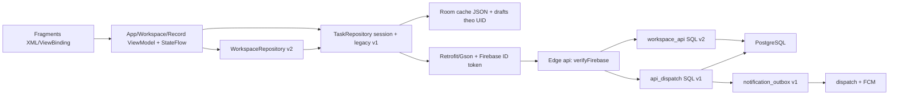

# Hiện trạng dự án 3DDK

Ngày khảo sát: **17/10/2026**. Checkout: `D:\LEARNING\Lap trinh ung dung di dong\PROJECT MOBILE`; nhánh `codex/teable-product-design`; commit được đọc: `2e64457d2f79a5774c5f7877c0a1cd1cd0668717`. Đây là khảo sát source và báo cáo đã có, **không chạy lại build/test, không gọi cloud, không sửa code hay database**. Liên kết bằng chứng dưới đây cố định vào commit này. Secret, `local.properties`, service account và keystore không được đọc.

**Yêu cầu mới người dùng đã xác nhận trong đợt nghiên cứu:** sản phẩm hướng tới công ty khoảng **100 người**. Câu trả lời tiếp theo “khoảng 20 người” được diễn giải là khoảng **20 người thao tác đồng thời**; cần xác nhận workload cụ thể trước khi kiểm thử tải. Đây là mục tiêu thiết kế, không phải năng lực đã chứng minh của bản preview. Số bản ghi mỗi bảng, lượng tệp và mốc nghiệm thu chưa biết; chưa thay hard cap hoặc dịch vụ cloud.

## 1. Kết luận có bằng chứng

- Sản phẩm hiện tại là **Android Kotlin/XML 0.2.0-preview**, một module `app`, Single Activity + Fragments. Luồng mặc định là Không gian → Cơ sở dữ liệu → Bảng → Dòng; bottom navigation có Không gian, Lời mời, Cá nhân. Không có web frontend trong repo. [Navigation](https://github.com/Duon-gg/3DDK-MOBILE/blob/2e64457d2f79a5774c5f7877c0a1cd1cd0668717/app/src/main/res/navigation/main.xml#L1), [menu](https://github.com/Duon-gg/3DDK-MOBILE/blob/2e64457d2f79a5774c5f7877c0a1cd1cd0668717/app/src/main/res/menu/bottom_nav.xml#L1).
- Có **hai hệ dữ liệu cùng tồn tại**: v1 quản lý việc cho một nhóm với LEADER/MEMBER, v2 bảng tùy biến với OWNER/EDITOR/VIEWER theo không gian. UI chính và `/me` dùng v2; API v1 và màn hình cũ còn trong source. Không có migration chuyển việc v1 sang bản ghi v2. [TaskRepository:27](https://github.com/Duon-gg/3DDK-MOBILE/blob/2e64457d2f79a5774c5f7877c0a1cd1cd0668717/app/src/main/java/com/threeddk/tasks/data/TaskRepository.kt#L27), [MainActivity:25](https://github.com/Duon-gg/3DDK-MOBILE/blob/2e64457d2f79a5774c5f7877c0a1cd1cd0668717/app/src/main/java/com/threeddk/tasks/MainActivity.kt#L25), [migration v2:1](https://github.com/Duon-gg/3DDK-MOBILE/blob/2e64457d2f79a5774c5f7877c0a1cd1cd0668717/supabase/migrations/202610040001_workspaces.sql#L1).
- Dữ liệu v2 đã linh hoạt ở mức cột metadata + `cells JSONB`, có kiểm tra loại dữ liệu, phân quyền backend, version bản ghi và chống request trùng. Chưa có mô hình saved view, quan hệ bảng, công thức hoặc query phân trang. [Schema và validation v2:2](https://github.com/Duon-gg/3DDK-MOBILE/blob/2e64457d2f79a5774c5f7877c0a1cd1cd0668717/supabase/migrations/202610040001_workspaces.sql#L2).
- Cache/nháp dùng Room; nhập nháp rồi bấm gửi thủ công. Đây là **đọc offline + nháp**, chưa phải cộng tác hoặc tự đồng bộ mọi thao tác khi offline. [WorkspaceRepository:8](https://github.com/Duon-gg/3DDK-MOBILE/blob/2e64457d2f79a5774c5f7877c0a1cd1cd0668717/app/src/main/java/com/threeddk/tasks/data/WorkspaceRepository.kt#L8), [RecordViewModel:90](https://github.com/Duon-gg/3DDK-MOBILE/blob/2e64457d2f79a5774c5f7877c0a1cd1cd0668717/app/src/main/java/com/threeddk/tasks/RecordViewModel.kt#L90).

## 2. Công nghệ và phiên bản khóa trong repo

| Thành phần | Thực tế trong source |
|---|---|
| Android/build | Kotlin 2.2.20; AGP 8.13.2; KSP 2.2.20-2.0.4; Gradle Wrapper 8.13; JDK target 17, CI JDK 21; compileSdk 35, targetSdk 34, minSdk 24; versionCode 2, versionName 0.2.0-preview |
| UI | XML, View Binding, Material 1.12.0, ConstraintLayout 2.2.0, RecyclerView 1.3.2; AppCompat 1.7.0; Fragment 1.8.6; Navigation 2.8.9; Light Material3, nhấn xanh |
| State/async | Lifecycle/ViewModel/runtime 2.8.7; Coroutines Android và Play Services 1.10.2; MutableStateFlow, lifecycle-aware collect |
| Local database | Room runtime/ktx/compiler 2.7.2, KSP, database schema version 1 |
| HTTP/JSON | Retrofit và converter Gson 2.11.0; Gson 2.11.0; OkHttp transitive qua Retrofit; không khóa riêng phiên bản runtime OkHttp trong dependency declaration |
| Cloud client | Firebase BoM 33.7.0, Firebase Auth + Messaging; Firebase được khởi tạo bằng BuildConfig/FirebaseOptions, không áp dụng plugin Google Services |
| Ảnh/bảo mật/diagnostic | Glide 4.16.0; security-crypto 1.1.0 (EncryptedSharedPreferences/MasterKey); LeakCanary debug 2.14; desugar_jdk_libs 2.1.5 |
| Backend | Supabase hosted PostgreSQL + Edge Functions TypeScript/Deno; `jose` 6.1.0; không có server Node phục vụ ứng dụng |
| Test | JUnit 4.13.2; MockWebServer 4.12.0; coroutines-test 1.10.2; Android runner 1.6.2, ext JUnit 1.2.1, Espresso 3.6.1; Node built-in test + PGlite 0.3.14; Deno npm dev dependency 2.5.4 |

Bằng chứng: [versions catalog:1](https://github.com/Duon-gg/3DDK-MOBILE/blob/2e64457d2f79a5774c5f7877c0a1cd1cd0668717/gradle/libs.versions.toml#L1), [Gradle app:8](https://github.com/Duon-gg/3DDK-MOBILE/blob/2e64457d2f79a5774c5f7877c0a1cd1cd0668717/app/build.gradle.kts#L8), [dependencies:32](https://github.com/Duon-gg/3DDK-MOBILE/blob/2e64457d2f79a5774c5f7877c0a1cd1cd0668717/app/build.gradle.kts#L32), [wrapper:3](https://github.com/Duon-gg/3DDK-MOBILE/blob/2e64457d2f79a5774c5f7877c0a1cd1cd0668717/gradle/wrapper/gradle-wrapper.properties#L3), [Deno config:1](https://github.com/Duon-gg/3DDK-MOBILE/blob/2e64457d2f79a5774c5f7877c0a1cd1cd0668717/supabase/functions/deno.json#L1), [package.json:4](https://github.com/Duon-gg/3DDK-MOBILE/blob/2e64457d2f79a5774c5f7877c0a1cd1cd0668717/package.json#L4).

Phiên bản PostgreSQL cloud, cấu hình hạn mức/quyền quản trị cloud và bản binary đang cài trên điện thoại **chưa được xác minh trong đợt này**. Không suy từ dependency lock ra trạng thái production.

## 3. Chức năng hiện có và giới hạn thực tế

| Nhóm | Đã triển khai | Giới hạn/không có |
|---|---|---|
| Tài khoản | Firebase Email/Password: đăng ký, xác minh, đăng nhập, gửi lại email, reset, nhớ email, logout; tài khoản mới v2 vào app tự tạo không gian | Không SSO, MFA, quản trị tài khoản hoặc khóa người dùng v2 trong app; email xác minh vẫn bắt buộc |
| Hồ sơ | Đổi tên, chọn 1/6 DiceBear URL; Glide placeholder/error/cache | Không upload avatar |
| Cấu trúc | Tạo nhiều workspace; tạo base; tạo table với cột Tên | Không sửa tên/xóa/lưu trữ workspace, base, table; không nhân bản/mẫu toàn dự án |
| Mẫu bảng công việc | Owner tạo thêm Mô tả TEXT, Trạng thái SELECT, Ưu tiên SELECT, Hạn DATE, Người phụ trách TEXT | 6 request riêng (1 table + 5 fields), chưa nguyên tử; Người phụ trách không liên kết UID; Chờ duyệt chỉ là nhãn SELECT |
| Cột | Owner thêm TEXT, NUMBER, DATE, CHECKBOX, SELECT; metadata id/name/type/options/position | Chưa sửa/xóa/ẩn/đổi thứ tự/đổi loại cột; SELECT dùng chuỗi nhãn, chưa có option ID ổn định; DATE chỉ ngày YYYY-MM-DD |
| Bản ghi | Thêm, mở màn hình sửa, lưu, lưu trữ mềm; viewer chỉ xem; nháp và conflict | Chưa sửa inline, chọn nhiều dòng, bulk, drag/drop, restore/archive browser, required field, validation riêng từng cột |
| Grid/query | RecyclerView hàng, cuộn ngang; tìm chuỗi trong các cell; lọc cột tên Trạng thái; sort cột DATE có tên chứa hạn/deadline | Không saved view/filter tổng quát/group/pagination/server search. Filter/sort chỉ biến cục bộ Fragment, mất khi tạo Fragment mới; mọi dòng tải hết |
| Cộng tác | Owner mời email làm EDITOR/VIEWER, lời mời hết hạn 7 ngày, người nhận chấp nhận trong app; owner xem/thu hồi lời mời chờ; xem danh sách thành viên | Chưa đổi role/xóa member/chuyển owner/rời workspace; không email mời tự động, không presence/realtime |
| Lịch sử/thông báo | v1 có review/history/outbox/FCM; v2 ghi ws_events mức route | v2 chưa có UI/API đọc audit/history, comment/mention hoặc push; không coi hạ tầng v1 đã hoàn thành thông báo v2 |
| Nội dung nâng cao | Không phát hiện trong route/schema/UI hiện có | Linked record, lookup, rollup, formula, attachment, import/export, Kanban/Calendar/Gallery/Form, dashboard, webhook/automation chưa triển khai |

Bằng chứng: [AppViewModel:60](https://github.com/Duon-gg/3DDK-MOBILE/blob/2e64457d2f79a5774c5f7877c0a1cd1cd0668717/app/src/main/java/com/threeddk/tasks/AppViewModel.kt#L60), [WorkspaceFragment:35](https://github.com/Duon-gg/3DDK-MOBILE/blob/2e64457d2f79a5774c5f7877c0a1cd1cd0668717/app/src/main/java/com/threeddk/tasks/ui/WorkspaceFragment.kt#L35), [mẫu bảng:40](https://github.com/Duon-gg/3DDK-MOBILE/blob/2e64457d2f79a5774c5f7877c0a1cd1cd0668717/app/src/main/java/com/threeddk/tasks/WorkspaceViewModel.kt#L40), [grid/filter:35](https://github.com/Duon-gg/3DDK-MOBILE/blob/2e64457d2f79a5774c5f7877c0a1cd1cd0668717/app/src/main/java/com/threeddk/tasks/ui/DataTableFragment.kt#L35), [field editor:35](https://github.com/Duon-gg/3DDK-MOBILE/blob/2e64457d2f79a5774c5f7877c0a1cd1cd0668717/app/src/main/java/com/threeddk/tasks/ui/RecordEditorFragment.kt#L35), [v2 route:87](https://github.com/Duon-gg/3DDK-MOBILE/blob/2e64457d2f79a5774c5f7877c0a1cd1cd0668717/supabase/migrations/202610040001_workspaces.sql#L87).

## 4. Luồng kiến trúc đang chạy



- `TasksApp` khởi tạo FirebaseOptions nếu có cấu hình và notification channel; repository singleton theo Application. [TasksApp:8](https://github.com/Duon-gg/3DDK-MOBILE/blob/2e64457d2f79a5774c5f7877c0a1cd1cd0668717/app/src/main/java/com/threeddk/tasks/TasksApp.kt#L8).
- `TaskRepository` chứa session, Room, secure email, cả transport v1/v2. `refresh()` chỉ tải v2 `/me`, không còn tải list v1; `WorkspaceRepository` tải từng resource path thành một JSON snapshot. [TaskRepository:17](https://github.com/Duon-gg/3DDK-MOBILE/blob/2e64457d2f79a5774c5f7877c0a1cd1cd0668717/app/src/main/java/com/threeddk/tasks/data/TaskRepository.kt#L17), [WorkspaceRepository:15](https://github.com/Duon-gg/3DDK-MOBILE/blob/2e64457d2f79a5774c5f7877c0a1cd1cd0668717/app/src/main/java/com/threeddk/tasks/data/WorkspaceRepository.kt#L15).
- Không có SDK Supabase Android, GraphQL, WebSocket hay realtime subscription. API tự viết chuyển method/path/body sang SQL function; không thể suy rằng REST CRUD/table truy cập trực tiếp đã được mở.

## 5. Database hiện tại

### V2: 11 bảng

| Bảng | Dữ liệu, quan hệ và ràng buộc chính |
|---|---|
| ws_profiles | Firebase uid PK; email, display_name, avatar_url; upsert từ token khi gọi API. Email không UNIQUE |
| ws_workspaces | UUID, tên 1–100, created_at |
| ws_members | PK(workspace_id,uid), FK workspace/profile, role OWNER/EDITOR/VIEWER; unique partial index bảo đảm tối đa 1 OWNER/workspace |
| ws_invites | UUID, workspace FK, email, EDITOR/VIEWER, expires_at mặc định +7 ngày, accepted_at/revoked_at |
| ws_bases | UUID, workspace FK, tên 1–100 |
| ws_tables | UUID, base FK, tên 1–100 |
| ws_fields | UUID, table FK, name/type/options JSONB/position; unique(table_id,name); 5 loại CHECK cố định |
| ws_records | UUID, table FK, cells JSONB theo field UUID, version, created/updated/archived_at; partial index(table_id,created_at,id) cho dòng chưa archive |
| ws_events | UUID, workspace FK, actor_uid FK, path, method, created_at; chưa chứa entity ID, before/after hoặc version |
| ws_requests | PK(uid,request_id), method/path/body/response để replay; chưa created_at/TTL/retention |
| ws_limits | uid PK, window_at/count, 60 mutation thành công/phút/UID |

Nguồn: [migration v2:2](https://github.com/Duon-gg/3DDK-MOBILE/blob/2e64457d2f79a5774c5f7877c0a1cd1cd0668717/supabase/migrations/202610040001_workspaces.sql#L2).

Validation cell: object JSON, `pg_column_size` ≤24.000 byte, chỉ field thuộc table; null được chấp nhận; TEXT chuỗi ≤5.000; NUMBER JSON number; CHECKBOX JSON boolean; DATE chuỗi đúng regex rồi cast date; SELECT chuỗi nằm trong options. Các field có thể bỏ trống và object `{}` hợp lệ; cột Tên không bắt buộc. Không có cấu hình precision/currency/timezone, default, unique hoặc computed. Loại field lạ bị CHECK constraint từ chối; error mapper SQL 22/23 trả VALIDATION. SELECT options backend có giới hạn 30 phần tử/100 ký tự, nhưng chưa chuẩn hóa nhãn trùng/trailing space thành option ID. [Validation:20](https://github.com/Duon-gg/3DDK-MOBILE/blob/2e64457d2f79a5774c5f7877c0a1cd1cd0668717/supabase/migrations/202610040001_workspaces.sql#L20), [tạo cột:120](https://github.com/Duon-gg/3DDK-MOBILE/blob/2e64457d2f79a5774c5f7877c0a1cd1cd0668717/supabase/migrations/202610040001_workspaces.sql#L120), [error mapper:9](https://github.com/Duon-gg/3DDK-MOBILE/blob/2e64457d2f79a5774c5f7877c0a1cd1cd0668717/supabase/functions/_shared/backend.ts#L9).

Giới hạn backend: 20 workspace sở hữu/UID; 50 base/workspace; 50 table/base; 30 field/table; 500 dòng chưa archive/table. Không có giới hạn số invite, member hoặc dòng archive, không TTL dọn request/event. [v2:93](https://github.com/Duon-gg/3DDK-MOBILE/blob/2e64457d2f79a5774c5f7877c0a1cd1cd0668717/supabase/migrations/202610040001_workspaces.sql#L93).

### V1: 11 bảng được giữ tương thích

`members`, `invites`, `tasks`, `task_assignees`, `submissions`, `task_events`, `notifications`, `device_tokens`, `notification_outbox`, `api_requests`, `api_limits`. Công việc có title/description/deadline UTC/priority/status/representative/version/archive; submissions bất biến theo lần nộp + kết quả review; task_events có before/after; thông báo/outbox có unique event key, lease/retry. Đây là schema nhóm đơn, **không gắn workspace v2**. [migration v1:1](https://github.com/Duon-gg/3DDK-MOBILE/blob/2e64457d2f79a5774c5f7877c0a1cd1cd0668717/supabase/migrations/202610030001_core.sql#L1), [event v1:188](https://github.com/Duon-gg/3DDK-MOBILE/blob/2e64457d2f79a5774c5f7877c0a1cd1cd0668717/supabase/migrations/202610030001_core.sql#L188).

### Room

Database `3ddk-tasks.db`, version 1; `cache` PK(owner,kind,id) chứa JSON; `drafts` PK(owner,taskId), description/link/requestId/expectedVersion. V2 tái dùng `Draft.description` để chứa JSON raw cell và key `v2/{resource}/{recordId}`; snapshot v2 key = resource path. Chưa có local record/field/view entities hoặc index phục vụ query offline. DAO observe tất cả cache của một UID rồi client tìm resource. Singleton an toàn đa luồng, DAO suspend/Flow, không destructive migration. [TaskDatabase:5](https://github.com/Duon-gg/3DDK-MOBILE/blob/2e64457d2f79a5774c5f7877c0a1cd1cd0668717/app/src/main/java/com/threeddk/tasks/data/TaskDatabase.kt#L5), [RecordViewModel:48](https://github.com/Duon-gg/3DDK-MOBILE/blob/2e64457d2f79a5774c5f7877c0a1cd1cd0668717/app/src/main/java/com/threeddk/tasks/RecordViewModel.kt#L48).

## 6. API và phân quyền hiện tại

Base URL `/functions/v1/api/v2`; header Firebase ID token. Edge dùng `jose` verify RS256, issuer, audience, exp/iat/sub/auth_time, email_verified; UID lấy từ signed token. Giới hạn request body 32KiB, mọi lỗi có code, request ID header, no-store. `verify_jwt=false` của Supabase là chủ ý vì kiểm tra Firebase riêng. [Edge:9](https://github.com/Duon-gg/3DDK-MOBILE/blob/2e64457d2f79a5774c5f7877c0a1cd1cd0668717/supabase/functions/api/index.ts#L9), [auth:2](https://github.com/Duon-gg/3DDK-MOBILE/blob/2e64457d2f79a5774c5f7877c0a1cd1cd0668717/supabase/functions/_shared/auth.ts#L2).

| Method/path v2 | Hành vi/quyền thực tế |
|---|---|
| GET/PATCH /me | Mọi UID email verified; đọc/sửa bản thân; PATCH displayName/avatar whitelist |
| GET/POST /workspaces | List workspace thành viên; tạo workspace và OWNER cho chính mình |
| GET /workspaces/{id} | Thành viên; trả base, member display name/role; pending invites chỉ OWNER |
| POST /workspaces/{id}/bases | OWNER/EDITOR |
| GET /bases/{id} | Thành viên workspace; list table |
| POST /bases/{id}/tables | OWNER/EDITOR; tạo table + cột Tên trong một transaction |
| GET /tables/{id} | Thành viên; toàn bộ fields và active records, role; không pagination |
| POST /tables/{id}/fields | Chỉ OWNER |
| POST /tables/{id}/records | OWNER/EDITOR; cells đã validate |
| PATCH /tables/{id}/records/{rid} | OWNER/EDITOR; thay toàn bộ cells, expectedVersion bắt buộc |
| DELETE /tables/{id}/records/{rid} | OWNER/EDITOR; soft archive, expectedVersion bắt buộc |
| POST /workspaces/{id}/invites | Chỉ OWNER; email + EDITOR/VIEWER |
| DELETE /workspaces/{id}/invites/{iid} | Chỉ OWNER; đặt revoked_at, không xóa member đã tham gia |
| GET /invitations | Pending, chưa revoke/hết hạn, email khớp token |
| POST /invitations/{iid}/accept | Email token khớp invite, chưa revoke/hết hạn; thêm membership nếu chưa có |

Nguồn toàn bộ route/quyền: [workspace_api:39](https://github.com/Duon-gg/3DDK-MOBILE/blob/2e64457d2f79a5774c5f7877c0a1cd1cd0668717/supabase/migrations/202610040001_workspaces.sql#L39). Backend tự resolve workspace qua base/table rồi lấy role từ ws_members; VIEWER bị chặn mọi mutation thuộc workspace. Không tin role client. Các bảng bật RLS, không policy client; revoke table/function đối với public/anon/authenticated; chỉ service_role gọi RPC qua Edge. Không phải Firebase UID được tự map vào Supabase auth.uid(). [Quyền DB:169](https://github.com/Duon-gg/3DDK-MOBILE/blob/2e64457d2f79a5774c5f7877c0a1cd1cd0668717/supabase/migrations/202610040001_workspaces.sql#L169), [RPC:2](https://github.com/Duon-gg/3DDK-MOBILE/blob/2e64457d2f79a5774c5f7877c0a1cd1cd0668717/supabase/functions/_shared/backend.ts#L2).

Lời mời đã accept không bị kiểm tra `accepted_at` tại endpoint accept; retry với request ID cũ replay, request ID mới vẫn kiểm tra expiry/revoke rồi `ON CONFLICT DO NOTHING` nên không cập nhật role membership đã có. Đây là hành vi source, chưa phải luồng quản lý role hoàn chỉnh. Phải chốt hành vi re-invite/rejoin khi thêm chức năng xóa thành viên. [Accept:153](https://github.com/Duon-gg/3DDK-MOBILE/blob/2e64457d2f79a5774c5f7877c0a1cd1cd0668717/supabase/migrations/202610040001_workspaces.sql#L153).

API v1 vẫn có `/me`, `/members`, `/invites`, `/devices`, `/notifications`, `/tasks`, task detail/history/start/submissions/review/reopen/archive. Chỉ LEADER tạo/sửa/giao/duyệt, representative bắt đầu/nộp; MEMBER active được đọc. Người ngoài cần lời mời v1; không tự thành LEADER. [api_dispatch:48](https://github.com/Duon-gg/3DDK-MOBILE/blob/2e64457d2f79a5774c5f7877c0a1cd1cd0668717/supabase/migrations/202610030001_core.sql#L48).

## 7. Đồng thời, retry, offline và an toàn dữ liệu

- Mutation v2 khóa advisory theo UID rồi workspace; lưu requestId/method/path/body/response trong cùng SQL transaction. Replay giống trả response cũ; cùng requestId khác payload trả CONFLICT. Sửa/archive lock row + version; version tăng một lần. Đây là optimistic concurrency cấp bản ghi, không CRDT/cell merge. [v2:62](https://github.com/Duon-gg/3DDK-MOBILE/blob/2e64457d2f79a5774c5f7877c0a1cd1cd0668717/supabase/migrations/202610040001_workspaces.sql#L62), [records:129](https://github.com/Duon-gg/3DDK-MOBILE/blob/2e64457d2f79a5774c5f7877c0a1cd1cd0668717/supabase/migrations/202610040001_workspaces.sql#L129).
- Table/base/field hiện chỉ create nên chưa có expectedVersion/schemaVersion; nếu bổ sung sửa field cần version schema và quy tắc tương thích với nháp cũ. `PATCH record` thay nguyên JSON; trước khi nâng version sau conflict, UI cảnh báo nội dung nháp sẽ thay dòng, chưa cho diff từng cell. [RecordEditor:23](https://github.com/Duon-gg/3DDK-MOBILE/blob/2e64457d2f79a5774c5f7877c0a1cd1cd0668717/app/src/main/java/com/threeddk/tasks/ui/RecordEditorFragment.kt#L23), [reconcile:74](https://github.com/Duon-gg/3DDK-MOBILE/blob/2e64457d2f79a5774c5f7877c0a1cd1cd0668717/app/src/main/java/com/threeddk/tasks/RecordViewModel.kt#L74).
- Client giữ requestId record trong Room nháp, chỉ xóa sau response thành công. Transport refresh token một lần trên 401 và giữ body. Form tạo workspace/base/field chỉ giữ requestId ở bộ nhớ ViewModel; process death sau server commit/mất response có thể làm retry bằng ID mới. Mẫu table tạo nhiều request riêng không rollback tự động khi thiếu cột. [Transport:21](https://github.com/Duon-gg/3DDK-MOBILE/blob/2e64457d2f79a5774c5f7877c0a1cd1cd0668717/app/src/main/java/com/threeddk/tasks/data/ApiTransport.kt#L21), [WorkspaceViewModel:33](https://github.com/Duon-gg/3DDK-MOBILE/blob/2e64457d2f79a5774c5f7877c0a1cd1cd0668717/app/src/main/java/com/threeddk/tasks/WorkspaceViewModel.kt#L33).
- Refresh v2 cập nhật snapshot sau server thành công, có kiểm tra UID trước khi ghi; lỗi mạng giữ snapshot. FORBIDDEN/UNAUTHORIZED/UNVERIFIED khi refresh xóa cache v2 của UID, giữ draft; account observer theo UID. Logout xóa toàn bộ cache/nháp local, signout và cố hủy FCM token. Có nhiều Mutex riêng (session/workspace/draft), **chưa có bằng chứng test race logout đồng thời save/mutation**; không kết luận đã có rò rỉ account. [WorkspaceRepository:15](https://github.com/Duon-gg/3DDK-MOBILE/blob/2e64457d2f79a5774c5f7877c0a1cd1cd0668717/app/src/main/java/com/threeddk/tasks/data/WorkspaceRepository.kt#L15), [logout:91](https://github.com/Duon-gg/3DDK-MOBILE/blob/2e64457d2f79a5774c5f7877c0a1cd1cd0668717/app/src/main/java/com/threeddk/tasks/data/TaskRepository.kt#L91).
- EncryptedSharedPreferences chỉ nhớ email; Room cache/nháp không mã hóa bằng thư viện này. Token do Firebase SDK quản lý. Backup bị tắt và data extraction rules loại database/sharedpref/files. Không thể giấu Firebase client configuration trong APK; bí mật backend không được gửi client. [Secure email:23](https://github.com/Duon-gg/3DDK-MOBILE/blob/2e64457d2f79a5774c5f7877c0a1cd1cd0668717/app/src/main/java/com/threeddk/tasks/data/TaskRepository.kt#L23), [manifest:5](https://github.com/Duon-gg/3DDK-MOBILE/blob/2e64457d2f79a5774c5f7877c0a1cd1cd0668717/app/src/main/AndroidManifest.xml#L5).

## 8. Những rủi ro cụ thể cần kế hoạch xử lý

| Mức ưu tiên | Phát hiện và ảnh hưởng | Bằng chứng/độ chắc chắn |
|---|---|---|
| P0 | Mẫu bảng thiếu cột nếu lỗi mạng; không nguyên tử, retry có thể tạo bảng khác sau process death | Đã xác minh source WorkspaceViewModel:40–52; chưa mô phỏng runtime đợt này |
| P0 | Hạ tầng push/Profile còn gọi v1; người dùng v2 không có membership v1 có thể gặp NOT_INVITED; thông báo v2 chưa hoàn chỉnh | ProfileFragment:18, TaskRepository:85; api/index.ts:26 chỉ kích dispatch cho v1; MainActivity:42 không mở task cũ |
| P0 | Thiếu thao tác đổi quyền/xóa thành viên đã tham gia; thu hồi invite không thu hồi truy cập member | Không có route v2 tương ứng; migration:146,153 |
| P0 | Tài liệu SETUP/API/TESTING/DELIVERY phần lớn là v1 và có câu cloud chưa tạo, mâu thuẫn PREVIEW-V2; team có thể seed/cấu hình nhầm | README:5 đã cảnh báo; docs/TESTING:44 vs PREVIEW-V2:40 |
| P0 | Chưa nghiệm thu hai tài khoản/thiết bị đồng thời, signed upgrade, permission revocation, font lớn và v2 push; source/test đơn lẻ không đủ xác nhận | PREVIEW-V2:49; không rerun trong khảo sát |
| P1 | Full-table JSON aggregate + whole snapshot Room + tạo tất cả cell view/hàng; tối đa 500 dòng chưa giải quyết query bảng lớn | SQL v2:116–119; DataTableFragment:84–90; WorkspaceRepository:12 |
| P1 | Không saved view; filter phụ thuộc tên cột tiếng Việt; không generic filter, stable option IDs, required field hay MEMBER field | DataTableFragment:43–61; TaskTableTemplate:6; ws_fields:13 |
| P1 | Audit chỉ route/time/actor, không đủ tìm lại sửa dòng/khôi phục phiên bản; ws_requests và events chưa retention | migration v2:16–18,163–164 |
| P1 | JWT verifier kiểm tra token chữ ký/claims nhưng không truy vấn Firebase revocation/disabled-user; scope xử lý account bị khóa cần chốt | auth.ts:2–6; đây là giới hạn code, không bằng chứng đã khai thác |
| P1 | Chưa schema version; raw JsonObject xuyên UI/VM/repo; thêm loại cell phức tạp đòi hỏi tương thích client/backend/cache | RecordViewModel:13,92; SQL ws_validate_cells:20 |
| P2 | Giới hạn tài nguyên chưa đầy đủ cho invite/archive/requests và GET; rate limiter hiện transaction rollback với request thất bại nên không đếm mọi abuse | migration v2:62–83,141–160; suy luận trực tiếp semantics giao dịch PostgreSQL, chưa tải thử |

Giữ công nghệ hiện có. Những điểm trên là phạm vi thiết kế/kiểm thử tiếp theo; báo cáo này không tự sửa hoặc mở rộng sản phẩm.

## 9. Thành phần nên tái sử dụng

| Thành phần | Tái sử dụng hợp lý | Cần điều chỉnh khi triển khai được duyệt |
|---|---|---|
| Firebase session, verifyFirebase, ApiTransport | Auth thật, JWT trust boundary, refresh một lần, timeout/error mapping | Quy trình revoked account và v2 device route |
| workspace_api + RLS/service_role boundary | Resolution workspace, RBAC, transaction, request replay, record version | Tách logic khi thêm query/views/field mutation; bổ sung schema version/audit |
| ws_fields + ws_records.cells | Nền metadata/custom fields, UUID field khóa ổn định | Mở rộng config/type validation; giữ tương thích dữ liệu cũ |
| Room/DAO owner key, WorkspaceRepository | Cache và draft không lẫn account theo thiết kế | Phân trang/query local, metadata snapshot timestamp, kiểm thử logout race |
| RecordViewModel/typedCells | Parse/validate 5 loại, draft bền, conflict | Registry type nhỏ khi có thêm nhiều loại; không cần framework mới ngay |
| WorkspaceFragment/RowAdapter/Material dialogs | Navigation, danh sách, tên/role/dialog reusable | Không nhét toàn bộ view mới vào một Fragment; UX điện thoại |
| v1 event/outbox worker | Pattern transaction → outbox → lease/retry FCM | Không reuse FK task/member v1 cho v2; tạo model/authorization workspace phù hợp |
| PGlite, MockWebServer, JWT tests, CI | Giao dịch/quyền/retry regression, source build gates | Thêm kiểm thử yêu cầu mới; hai thiết bị thật và migration/upgrade riêng |

## 10. Kiểm thử: source, bằng chứng cũ và chưa xác minh

- **Đang có trong source:** 14 Node/PGlite case (9 v1 + 5 workspace), 2 Deno JWT case; 11 Android unit case ở 6 file; 6 instrumentation case (Launch 1, OfflineDatabase 3, WorkspaceLive 1, WorkspaceEditLive 1). Hai live test chỉ chạy khi `liveWorkspace=true`, yêu cầu account verified đang đăng nhập và **tạo dữ liệu cloud mẫu**, không chạy trong đợt phân tích. [Node workspace tests:17](https://github.com/Duon-gg/3DDK-MOBILE/blob/2e64457d2f79a5774c5f7877c0a1cd1cd0668717/tests/workspaces.test.mjs#L17), [live test:22](https://github.com/Duon-gg/3DDK-MOBILE/blob/2e64457d2f79a5774c5f7877c0a1cd1cd0668717/app/src/androidTest/java/com/threeddk/tasks/WorkspaceLiveTest.kt#L22).
- **Báo cáo cục bộ đã đọc:** `app/build/test-results/testDebugUnitTest/TEST-*.xml` có timestamp UTC 16/10/2026 19:07:32–33 (17/10/2026 02:07 giờ Việt Nam); cộng 11 test, 0 skipped/failure/error. Đây là kết quả có sẵn trước khảo sát, không chứng minh toàn bộ source/cloud hiện tại đã được chạy lại. Thư mục build bị ignore và không là bằng chứng kiểm toán version-controlled.
- **Báo cáo commit ngày 04/10:** PREVIEW-V2 ghi 14 database, 2 JWT, Deno check, 9 Android unit, lint, signed APK/AAB và hai test trên điện thoại với một tài khoản đã đạt. 9 unit là số lịch sử trước khi thêm TableView/TaskTableTemplate, không sửa thành số mới để làm như đã chạy cùng đợt. [PREVIEW-V2:40](https://github.com/Duon-gg/3DDK-MOBILE/blob/2e64457d2f79a5774c5f7877c0a1cd1cd0668717/docs/PREVIEW-V2.md#L40).
- **CI khai báo:** backend npm ci/test/JWT/typecheck; Android JDK21/SDK35 unit/lint/debug; không instrumentation cloud, không production secrets, không release signing. Không kiểm tra GitHub run mới trong đợt này. [CI:8](https://github.com/Duon-gg/3DDK-MOBILE/blob/2e64457d2f79a5774c5f7877c0a1cd1cd0668717/.github/workflows/ci.yml#L8).
- **Chưa có bằng chứng:** load/performance nhiều bản ghi, role revocation v2, race account switch/async draft, process death giữa create template, bảng nhiều view, storage attachments, realtime/concurrent two-device, restore/archive UI, signed upgrade giữ Room/draft, accessibility toàn luồng. Không đánh dấu các nhóm này đạt.

## 11. Toàn bộ cấu trúc tracked và vai trò

Kiểm kê bằng `git ls-files`; repo có 94 tracked file tại commit khảo sát. Các build output, secrets và runtime ignored không thuộc danh sách này. Hai đường dẫn untracked có sẵn `docs/Ban-de-xuat-y-tuong-3DDK.docx`, `docs/huong-dan-test/` được giữ nguyên, không đọc/sửa. Không tìm thấy AGENTS.md tracked; quy định người dùng cung cấp và RTK.md ngoài repo được áp dụng.

```text
.github/workflows/ci.yml                 CI backend + Android
.gitignore                               secrets/build/runtime exclusions
README.md                                giới thiệu v2 + chỉ dẫn tài liệu v1
build.gradle.kts                         khai báo plugin root
settings.gradle.kts                      repositories + duy nhất :app
gradle.properties                        JVM/AndroidX/Kotlin flags
gradle/libs.versions.toml                 AGP/Kotlin/KSP
gradle/wrapper/gradle-wrapper.jar         Gradle Wrapper binary
gradle/wrapper/gradle-wrapper.properties  URL distribution và timeout/settings
gradlew                                  launcher Unix
gradlew.bat                              launcher Windows
local.properties.example                 tên config client, giá trị trống
package.json                             test/check scripts, PGlite/Deno
package-lock.json                        khóa cây dependency backend checks
app/build.gradle.kts                     SDK/deps/buildConfig/signing/ViewBinding
app/proguard-rules.pro                   giữ data DTO + annotation/signature
app/schemas/com.threeddk.tasks.data.TaskDatabase/1.json  Room export schema
app/src/main/AndroidManifest.xml         Activity/Application/FCM/permissions/backup
app/src/main/java/com/threeddk/tasks/
  TasksApp.kt                            Firebase + channel + repository
  MainActivity.kt                        binding/nav/session/push intent
  AppViewModel.kt                        session/auth/profile + v1 helper methods
  WorkspaceViewModel.kt                  snapshot/mutation/retry/template v2
  RecordViewModel.kt                     typed cell/draft/conflict/archive v2
  data/
    ApiTransport.kt                      Retrofit verbs, 401 retry/error code
    Models.kt                            typed model/labels/rules/error map v1
    TaskDatabase.kt                      Room entities/DAO/singleton/access failure
    TaskEditSession.kt                   request identity/version editor v1
    TaskMessagingService.kt              FCM token callback + notification v1
    TaskRepository.kt                    session/Room/secure prefs/transports/v1
    TaskTableTemplate.kt                 5 metadata fields mẫu công việc
    TableView.kt                         filter/search/sort local
    WorkspaceRepository.kt               v2 resource snapshot/mutation/draft
  ui/
    AuthFragment.kt                      login/register/verify/reset/setup states
    WorkspaceFragment.kt                 list hierarchy/create/invite/members
    DataTableFragment.kt                 grid/filter/search/sort/add field
    RecordEditorFragment.kt              typed controls/save/conflict/archive
    ProfileFragment.kt                   name/avatar/logout/notification settings
    OverviewFragment.kt                  list/filter/team/invites/notice v1
    DetailFragment.kt                    start/submit/review/history/archive v1
    EditorFragment.kt                    title/deadline/assignees/editor v1
    Ui.kt                                watch lifecycle + reusable RowAdapter
app/src/main/res/
  drawable/ic_app.xml                    icon app/grid
  drawable/ic_bell.xml                   icon thông báo
  drawable/ic_person.xml                 icon người/avatar placeholder
  drawable/ic_team.xml                   icon nhóm/lời mời
  layout/activity_main.xml               toolbar/progress/NavHost/bottom nav
  layout/dialog_input.xml                text/choice/extra reusable dialog
  layout/fragment_auth.xml               auth form
  layout/fragment_data_table.xml         header/search/actions/horizontal grid
  layout/fragment_detail.xml             chi tiết task v1
  layout/fragment_editor.xml             task form v1
  layout/fragment_overview.xml           heading/search/filter/RecyclerView
  layout/fragment_profile.xml            avatar/profile/logout
  layout/fragment_record_editor.xml      dynamic field container/save/reconcile
  layout/item_field_editor.xml           text/checkbox/select row
  layout/item_row.xml                    MaterialCardView cho danh sách
  menu/bottom_nav.xml                    Không gian/Lời mời/Cá nhân
  navigation/main.xml                    v2 destinations + legacy v1 destinations
  values/themes.xml                      Material3 Light, xanh/nhạt
  xml/data_extraction_rules.xml          loại backup/transfer dữ liệu
app/src/test/java/com/threeddk/tasks/
  ApiTransportTest.kt                    401 retry giữ body, conflict
  TableViewTest.kt                       local search/filter/date sort
  TaskEditSessionTest.kt                 retry identity/version reconciliation
  TaskRulesTest.kt                       representative/overdue/HTTPS
  TaskTableTemplateTest.kt               mẫu có status/deadline
  TypedCellsTest.kt                      parse number/null/date/choice
app/src/androidTest/java/com/threeddk/tasks/
  LaunchTest.kt                          unconfigured launch/recreate
  OfflineDatabaseTest.kt                 cache transaction/draft/isolation/access
  WorkspaceEditLiveTest.kt               opt-in UI draft/recreate/submit cloud
  WorkspaceLiveTest.kt                   opt-in create table/grid cloud
supabase/
  .env.example                          tên secrets backend, trống
  config.toml                           project alias, verify_jwt=false
  functions/deno.json                    jose import + strict TypeScript
  functions/deno.lock                    Deno dependency integrity lock
  functions/_shared/auth.ts              Firebase signed token verifier
  functions/_shared/auth_test.ts         JWT tests
  functions/_shared/backend.ts           env/RPC/error/secret comparison helpers
  functions/api/index.ts                 HTTP auth/body/router v1/v2
  functions/dispatch/index.ts            secret-protected outbox/FCM v1 worker
  migrations/202610030001_core.sql        v1 schema/RPC/outbox/security
  migrations/202610040001_workspaces.sql  additive v2 schema/RPC/security
  setup-scheduler.sql                    Vault + pg_cron/pg_net worker each minute
tests/
  database.test.mjs                      PGlite v1 permission/state/outbox checks
  workspaces.test.mjs                    PGlite v2 isolation/role/type/version checks
docs/
  API.md                                v1 API/schema/RBAC, không phải v2 spec
  DELIVERY.md                           lịch sử signed config preview v1
  IMPLEMENTATION-V2.md                   phạm vi/v2 thứ tự triển khai
  IMPLEMENTATION.md                      lịch sử v1/build/review
  OPERATIONS.md                          backup/restore/release/Git quy trình v1
  PREVIEW-V2.md                          cách dùng/giới hạn/bằng chứng v2
  SETUP.md                               cloud/seed v1/secrets/scheduler/signing
  TEABLE-DESIGN.md                       định hướng thiết kế, không phải đã làm
  TESTING.md                            test commands + checklist chủ yếu v1
  teable-backlog.csv                     backlog dự án gốc, không trạng thái runtime
```

Không có LICENSE ở root trong danh sách tracked; không suy repo công khai cho phép copy mọi mã. Những thiết kế tương lai phải đối chiếu giấy phép nguồn tham khảo riêng.

## 12. Những thông tin cần chủ dự án xác nhận

1. Mốc nghiệm thu tiếp theo chốt ở quản lý việc theo workspace/bảng, hay bắt buộc mang lại quy trình nộp/duyệt v1? Hiện v2 chỉ có nhãn trạng thái tự sửa.
2. Ai được tạo base/table và quản lý cấu trúc: giữ EDITOR tạo base/table như hiện tại, hay chuyển cấu trúc về OWNER và chỉ cho EDITOR sửa dòng?
3. Với mục tiêu công ty khoảng 100 người và câu trả lời được diễn giải là khoảng 20 người thao tác đồng thời: xác nhận workload này, số bản ghi mỗi bảng, lượng tệp dự kiến và ngày nghiệm thu. Hiện hard cap 500 active records và chưa có kết quả tải; cần số liệu trước khi chốt capacity/load test.
4. Cache/nháp offline cần đọc và soạn thủ công như hiện tại hay phải tự đồng bộ thao tác? Cần chốt retention dữ liệu khi mất quyền.
5. Có yêu cầu lưu/chuyển dữ liệu v1 đang có sang v2 không? Không tự thực hiện chuyển hoặc xóa dữ liệu cũ.

Các câu hỏi này là quyết định sản phẩm; tài liệu kiến trúc đi kèm cần ghi rõ lựa chọn đề xuất đang chờ duyệt, không giả định đã được người dùng chấp thuận.
