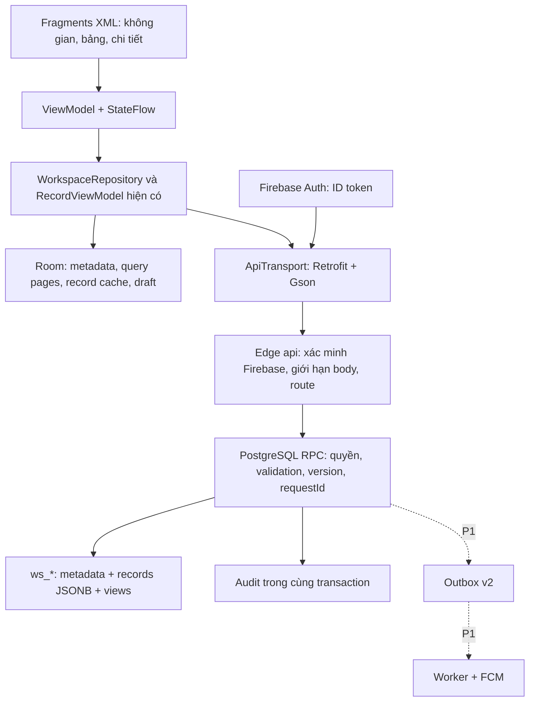

# Kiến trúc đề xuất cho 3DDK

Ngày nghiên cứu: 17/10/2026. **Đề xuất để duyệt; chưa triển khai.** Đọc cùng [hiện trạng](PROJECT_CURRENT_STATE.md), [database](DATABASE_DESIGN.md), [API](API_SPECIFICATION.md) và [roadmap](IMPLEMENTATION_ROADMAP.md).

## 1. Quyết định nền tảng

Giữ Android Kotlin/XML, một Activity + Fragments, ConstraintLayout, RecyclerView/Material, View Binding, MVVM/StateFlow, Room, Retrofit/Gson/Coroutines, Firebase Auth, Glide, EncryptedSharedPreferences và Supabase PostgreSQL/Edge Functions. Không chuyển sang React, Compose, WebView, backend Teable hay một dịch vụ database khác trong đề xuất này. Phần backend TypeScript/SQL tiếp tục như repo; yêu cầu Kotlin được hiểu cho mã Android như quyết định trước đây, cần xác nhận với giảng viên nếu rubric yêu cầu cả backend phải Kotlin.

Phân hệ bảng v2 là nền của sản phẩm. V1 tiếp tục phục vụ APK/dữ liệu cũ; chưa tự chuyển công việc v1 vào bảng. Không nhập mã nguồn Teable vào dự án. Quan sát chức năng và hợp đồng dữ liệu để thiết kế cách thực hiện độc lập; giấy phép từng phần nguồn phải được kiểm tra lại nếu sau này đề xuất tái sử dụng mã.

P0 làm lõi đáng tin: tạo bảng nguyên tử, quyền cộng tác, trường người phụ trách, saved Grid view, query có phân trang, nháp/xung đột, audit. P1 thêm cách xem và cộng tác. P2 là các ứng viên nâng cao, **không phải phạm vi đã chốt**.

## 2. Thành phần và đường đi dữ liệu

Không tạo service cho từng field hoặc microservice mới. Tiếp tục Edge làm biên xác thực, database làm biên giao dịch. Khi dispatcher lớn hơn, chia thành hàm SQL nội bộ theo resource; không biến mỗi hàm đó thành một RPC public. Quyền EXECUTE chỉ service_role ở Edge. RLS vẫn bật, client không được SELECT trực tiếp bảng nghiệp vụ. Service role có khả năng vượt RLS nên **mọi hàm đặc quyền vẫn phải kiểm tra membership và phạm vi resource**. [Cơ sở: Supabase RLS](https://supabase.com/docs/guides/database/postgres/row-level-security).

## 3. Metadata, kiểu cột và nhiều view

- Tiếp tục `ws_tables` → `ws_fields` và `ws_records.cells` với key là UUID field. Không đổi mọi bảng người dùng thành bảng vật lý PostgreSQL trong P0.
- Tách cấu hình field (`type`, options/config, version) khỏi cách hiển thị field trong một view. Validation phía server quyết định giá trị hợp lệ; Android kiểm tra sớm để hỗ trợ nhập.
- Field mới cần đúng ba điểm mở rộng hiện hữu: validation server, chuyển kiểu Android và editor/renderer Android; thêm test hợp đồng cho cả ba. Chưa cần framework plugin.
- `ws_views` chỉ lưu cấu hình query/hiển thị và version. Grid, Kanban, Calendar, Gallery, Form dùng chung record IDs; không sao chép bảng dữ liệu cho từng view.
- P0 chỉ có Grid được lưu; P1 thêm Kanban theo SELECT, Calendar theo DATE. Gallery cần lựa chọn cover; Form cần chính sách nộp dữ liệu riêng. Các view này chưa được thêm vào sản phẩm.
- Cấu hình tham chiếu field ID, không suy luận từ tên “Trạng thái” hoặc “Hạn”. Mẫu công việc có `system_key` để tên cột có thể đổi mà hành vi không hỏng. `ws_fields.position` là thứ tự mặc định toàn table do Owner quản lý; `view.field_order` chỉ ghi đè thứ tự hiển thị trong view đó, tăng view version, không sửa schema.
- View có thể dùng chung hoặc cá nhân; bộ lọc và cột ẩn **không cấp hay giới hạn quyền dữ liệu**. Nếu cần bảo mật từng dòng/cột, đó là một phân hệ phân quyền khác phải duyệt riêng.

## 4. Query và hiệu năng

Tách metadata khỏi danh sách records. API cũ `GET /tables/{id}` giữ hợp đồng cho APK cũ ở giới hạn hiện tại; client mới dùng metadata và query theo trang. Không tăng trần 500 dòng của API cũ chỉ vì UI mới có phân trang.

Query dùng AST filter có allowlist, sort theo kiểu dữ liệu, projection field IDs, `limit` và cursor có thứ tự xác định. P0 mặc định sort theo `created_at,id`; custom sort luôn thêm `id` làm khóa phụ. `null` đứng cuối. DATE là ngày lịch ISO, không tự chuyển timezone; deadline có giờ cần kiểu DATETIME riêng ở P1. Không nối tên cột/toán tử client thành SQL. Lấy table/field từ catalog thuộc workspace trước khi tạo query.

Cursor gắn UID, table/view version, schema version, query hash và last sort values; thay đổi cấu hình thì buộc tải trang đầu. Phân trang live không được quảng cáo là snapshot nhất quán giữa các lần đọc: record đổi khóa sort có thể di chuyển. Client khử trùng theo ID; thông báo dữ liệu thay đổi và refresh. Export cần snapshot/job riêng để tránh bỏ sót.

Index B-tree theo table và khóa sắp xếp mặc định trước. Chỉ thêm expression index cho field được đo là nóng, hoặc projection có kiểu, sau benchmark. GIN JSONB phù hợp một số phép tìm containment, **không tự làm mọi sort/date range nhanh**. [PostgreSQL JSONB](https://www.postgresql.org/docs/current/datatype-json.html), [expression indexes](https://www.postgresql.org/docs/current/indexes-expressional.html).

Người dùng xác nhận mục tiêu **công ty khoảng 100 người**; câu trả lời tiếp theo “khoảng 20 người” được hiểu là tải đỉnh khoảng 20 người cùng thao tác. Số dòng/bảng và tỷ lệ đọc/ghi vẫn chưa biết; cần xác nhận cách diễn giải mốc 20 khi chốt workload. Tạm giữ cap hiện có trong sản phẩm cho đến khi triển khai và benchmark được duyệt. Bộ test đề xuất có 100 tài khoản synthetic, các mức 1/5/20 người thao tác đồng thời, bảng 500 dòng và 5.000 dòng local/staging để tìm điểm nghẽn; 5.000 là workload thí nghiệm, không phải cam kết hay quyền tăng hạn mức production. Chốt SLA, chi phí và giới hạn sau khi có workload và đo thiết bị/mạng đích. Không gọi bản hiện tại là đã sẵn sàng cho công ty 100 người.

## 5. Mutation, chống ghi đè và audit

Một mutation được xử lý theo thứ tự: token đã xác minh → resolve resource → membership/role → requestId/fingerprint → version/schemaVersion → validation → cập nhật → audit/outbox → lưu response idempotency → commit. Mọi thành phần cuối cùng cùng transaction. Không phát FCM trước commit.

P0 giữ xung đột ở cấp record: hai thao tác cùng `expectedVersion` chỉ một thành công; thao tác còn lại nhận 409, giữ nháp. Cell patch chỉ gửi field thay đổi nhưng vẫn kiểm tra version cả record; **chưa tự merge hai người sửa hai cột khác nhau**. Khi schema đổi, trả `SCHEMA_CHANGED`, không âm thầm bỏ field hoặc chuyển kiểu nháp.

Tạo mẫu công việc là một mutation server tạo table + fields + default Grid view; mất kết nối sau commit thì retry cùng requestId nhận lại cùng ID. Không để client tạo mẫu bằng chuỗi POST fields như hiện nay. Giữ khóa account/workspace hiện tại ở P0 để tránh phá tính đúng; chỉ giảm phạm vi khóa sau khi có benchmark và kiểm thử deadlock/idempotency/limit.

Audit v2 bổ sung resource/entity ID, version trước/sau, field delta và timestamp server. Lịch sử record và log vận hành là hai thứ khác nhau: log vận hành không ghi token/nội dung kết quả; lịch sử nghiệp vụ chứa dữ liệu nên chỉ người có quyền đọc record được xem. Retention và quyền xuất lịch sử là quyết định cần duyệt.

## 6. Offline và cập nhật nhiều người

Room vẫn là nguồn UI quan sát. Mở màn hình hiển thị cache, sau đó refresh qua repository và ghi local trong transaction. Metadata, records và membership cache có UID/workspace/table scope rõ ràng. Cần thêm bảng cache query-membership theo `uid,viewId,queryHash,page` để không trộn các trang hoặc xem một phần cache như toàn bộ kết quả.

Nháp độc lập với record cache, có baseVersion/schemaVersion/requestId và tồn tại sau khởi động lại. Không tự gửi khi có mạng lại. Save chỉ xóa nháp sau xác nhận thành công; logout vẫn cảnh báo và xóa dữ liệu local theo chính sách hiện có. Thu hồi quyền khi online phải vô hiệu query cache workspace đó và chặn gửi; nháp cá nhân còn để sao chép nếu chính sách được duyệt. Không thể thu hồi ngay nội dung đã tải trên thiết bị đang offline.

Android khuyến nghị repository kết hợp local/network và UI đọc local trong kiến trúc offline; đề xuất này giữ cách tổ chức đó, không chuyển sang Firestore. [Android offline architecture](https://developer.android.com/topic/architecture/data-layer/offline-first).

P0 refresh khi mở lại màn hình hoặc bấm Làm mới. P1 xem xét invalidation qua push/polling trước; realtime subscription chỉ sau khi chứng minh auth Firebase + RLS và hạn mức hỗ trợ. Không tự thêm Supabase Realtime trực tiếp bằng service_role vào app.

## 7. Quyền, tệp và tích hợp

Giữ OWNER/EDITOR/VIEWER ở workspace. Owner quản lý schema, shared views, lời mời/quyền; Editor sửa records và personal views; Viewer đọc. Transfer owner cần transaction đảm bảo đúng một owner, không cho vô tình mất chủ. Không thêm ADMIN, role theo base hay chia sẻ public mặc định khi chưa duyệt.

Nếu duyệt Viewer lưu personal view trên server, phải thay guard hiện đang cấm mọi mutation của VIEWER thành quyền theo action: sửa cấu hình cá nhân của chính UID được phép, sửa records/schema/member vẫn bị chặn. Không chỉ mở POST cho Viewer toàn bộ. Nếu không duyệt ngoại lệ này, Viewer chỉ dùng shared view hoặc lựa chọn tạm trên máy, chưa tạo personal view server.

Firebase ID token phải kiểm tra chữ ký, audience, issuer, thời hạn và email_verified; UID/email dùng claim đã kiểm chứng. Cần quyết định chính sách tài khoản bị disable/revoke token vì xác minh JWT thuần không tự chứng minh trạng thái Firebase mới nhất. [Firebase custom backend verification](https://firebase.google.com/docs/auth/admin/verify-id-tokens).

P1 attachments dùng private bucket, metadata liên kết record và URL ký ngắn hạn sau khi kiểm tra quyền; không lưu URL công khai như một quyền truy cập. P2 webhook/automation là tác vụ nền có outbox, retry, quota, secret riêng và phòng SSRF. Đó là thiết kế dự kiến, chưa có hạ tầng chạy v2 này. [Supabase Storage access control](https://supabase.com/docs/guides/storage/security/access-control).

Tại lần đọc bảng giá chính thức 17/10/2026, Supabase Free ghi database 500 MB, file storage 1 GB, egress 5 GB và có thể pause sau một tuần không hoạt động; các con số này không chứng minh đủ tải đỉnh 20 người. Không dùng quota Supabase Auth MAU để ước lượng Firebase Auth, vì repo dùng Firebase. Cần đo cả Edge invocations, database growth/audit, băng thông và storage; không tự chuyển gói hoặc gắn thẻ. [Supabase pricing](https://supabase.com/pricing), [Firebase pricing](https://firebase.google.com/pricing).

## 8. Nâng cấp và điều kiện thông qua

Migration chỉ bổ sung tương thích ở các bước đầu; không xóa v1, `cells` hay Room drafts. Backup và diễn tập restore trên môi trường thử trước cloud migration. Feature capability phải được server báo để APK mới không giả định endpoint template/views đã triển khai. Tắt tính năng là rollback ưu tiên; không rollback bằng cách DROP bảng vừa có dữ liệu người dùng.

**Tương thích kiểu mới:** capability không bảo vệ APK cũ khỏi nhận JSON array rồi crash ở editor `asString`. Khi một table bật USER hoặc kiểu mới ngoài năm kiểu cũ, legacy snapshot và legacy mutation thiếu schema contract phải trả409 `CLIENT_UPGRADE_REQUIRED` trước khi trả cells/ghi. APK mới dùng metadata/query và expectedSchemaVersion. Bảng chỉ năm kiểu cũ vẫn phục vụ legacy. Đây là giới hạn tương thích cần duyệt và thông báo cập nhật APK trước khi bật type mới; không serialize array thành text, giấu field hoặc full-replace làm rơi ô chưa biết.

P0 chỉ đạt khi: token sai và truy cập chéo workspace bị chặn; template không tạo nửa bảng; version/idempotency đúng; saved view giữ cấu hình sau mở lại; phân trang không trộn query; nháp không mất sau lỗi/nâng cấp; hai tài khoản chạy được trên hai thiết bị; build debug/release và các test có bằng chứng tương ứng. Hiện chưa tuyên bố đạt các điều kiện mới này.

## 9. Cần người dùng quyết định

1. Duyệt P0/P1/P2 và saved view cá nhân/dùng chung; P2 chỉ nghiên cứu đến khi duyệt.
2. Đã chốt mục tiêu công ty 100 người, tải đỉnh được hiểu khoảng 20 người cùng thao tác; còn số dòng/bảng, tỷ lệ đọc/ghi, hạn mức và ngày bàn giao. Câu hỏi đã gửi; chưa dùng workload thử nghiệm làm yêu cầu thật.
3. Phạm vi quyền: workspace có đủ không hay cần bảo mật từng base/table/field? Chưa đưa granular ACL vào P0.
4. Có yêu cầu quy trình nộp/duyệt bắt buộc như v1 không? Hiện trạng thái v2 là dữ liệu tự do, không tự biến thành workflow bắt buộc.
5. Retention audit/attachments, file size và ngân sách dịch vụ. Không mở upload/webhook công khai trước khi có quyết định.
