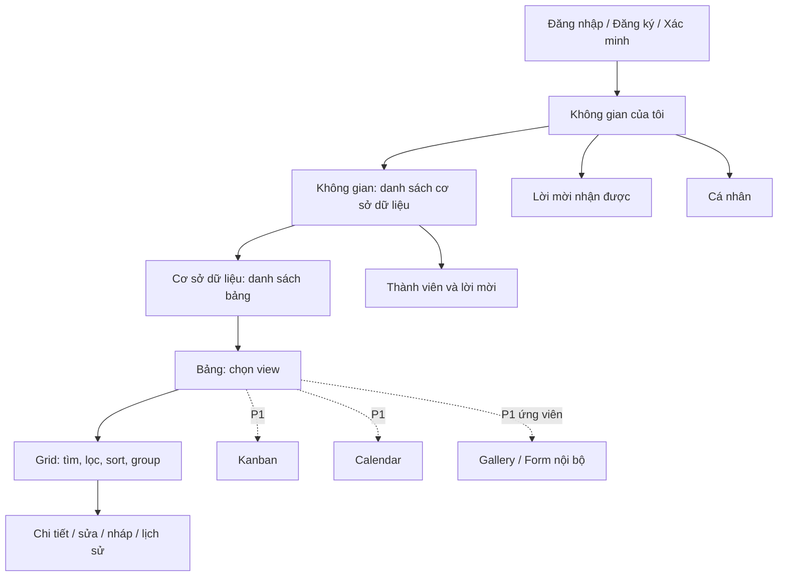

# Đặc tả giao diện và tương tác Android

Ngày: 17/10/2026. **Đề xuất, chưa phải màn hình đã xây hoặc đã test người dùng.** Tham chiếu hành vi sản phẩm trong [inventory](FEATURE_INVENTORY.md); không sao chép logo, ảnh, tên thương mại hay giao diện pixel của Teable/Airtable. Giữ Kotlin/XML và Material hiện tại.

## 1. Nguyên tắc và phân biệt hiện trạng

Mục tiêu là người trong công ty khoảng 100 người có thể tìm việc, hiểu ai phụ trách và cập nhật mà không cần hiểu database. Câu trả lời về tải đỉnh được hiểu khoảng 20 người cùng thao tác; số dòng/bảng và tỷ lệ đọc/ghi vẫn cần xác nhận, chưa có benchmark.

Hiện có ba tab **Không gian / Lời mời / Cá nhân**, màn hình bảng ngang và form sửa dòng. P0 tiếp tục khung đó để giảm thay đổi; không tự thay tab Lời mời thành thông báo khi thông báo v2 chưa có. Trong nội dung dùng “Công việc” ở template, “Dòng dữ liệu” ở bảng tùy chỉnh, và giữ “Không gian / Cơ sở dữ liệu / Bảng” nhất quán. Có thể thêm giải thích “Cơ sở dữ liệu là nơi chứa các bảng của một dự án”. Đổi nhãn thành “Dự án” cần duyệt để tránh lẫn Base với project record.

Nền sáng, chữ tối, nhấn xanh theo theme hiện có. Màu trạng thái luôn có chữ; không dùng hiệu ứng liquid-glass làm nền đọc dữ liệu. Trích xuất chuỗi và màu vào resources khi triển khai; tránh tiếp tục thêm text/màu rải trong Kotlin. Không đổi thư viện UI trong đợt này.

## 2. Sơ đồ màn hình



Back quay đúng cấp; breadcrumb hoặc tiêu đề phụ cho biết không gian/base/table hiện tại. Đổi tài khoản không khôi phục breadcrumb của tài khoản trước. Deep link notification phải đăng nhập và kiểm tra quyền rồi mới hiện record.

## 3. Đăng nhập và bước bắt đầu

- Bất kỳ ai có thể tạo tài khoản và không gian riêng; không hiển thị “chưa được mời” như lỗi chặn toàn bộ app v2.
- Dữ liệu công ty chỉ hiện khi có membership trong không gian đó. Đăng ký công khai không đồng nghĩa đọc được dữ liệu công ty.
- Email xác minh có nút gửi lại, kiểm tra trạng thái và đổi tài khoản; báo lỗi theo nguyên nhân thực tế, không đổi lỗi mạng thành thiếu quyền.
- Không gian rỗng: giải thích một câu và nút **Tạo không gian**. Lời mời là lựa chọn riêng. Không tự tạo dữ liệu demo trong không gian công ty.
- Tạo bảng: chủ không gian chọn **Bảng công việc** hoặc **Bảng trống**, nhập tên. Một trạng thái đang tạo; disable gửi lặp; timeout hiển thị **Kiểm tra kết quả / Thử lại** dùng cùng requestId. Không yêu cầu người dùng tự thêm cột thiếu.
- Template thành công mở bảng mặc định; các cột: Tên, Mô tả, Trạng thái, Ưu tiên, Hạn, Người phụ trách. Cột USER cần backend hỗ trợ, không chỉ đổi một input text thành spinner.

## 4. Grid P0

Bố cục tham khảo do 3DDK tự thiết kế:

```text
‹ Cơ sở dữ liệu                 Công việc nhóm          ⋮
Đã cập nhật 09:30 / Đang ngoại tuyến — dữ liệu đã tải
[View: Tất cả công việc ▾]                  [+ Thêm việc]
[Tìm trong bảng                                      ]
[Lọc (2)]  [Sắp xếp (1)]  [Cột]        [Nhóm: P1]
Tên                   Trạng thái      Hạn        Người phụ trách
Kiểm thử đăng nhập    Đang làm        20/10       Nguyễn A
Chuẩn bị bản dùng thử Chưa làm        22/10       Nguyễn B
                         Đang tải trang tiếp theo…
```

- Một nguồn records; đổi view không tạo bản sao. Header có tên cột/kiểu, cuộn ngang để xem thêm. P0 ưu tiên đọc được và mở chi tiết; freeze cột/resize kéo là phần P1 sau benchmark và kiểm thử trợ năng.
- Cột chính đủ rộng, text dài tối đa vài dòng trong grid; mở chi tiết để đọc đầy đủ. Không bắt người dùng sửa một đoạn dài trong ô hẹp.
- Thanh công cụ hiển thị trực tiếp filter/sort thay vì giấu hết trong menu ⋮. Nút đang áp dụng có số điều kiện. Có **Xóa bộ lọc** để thoát kết quả rỗng.
- Phân trang vô hạn hoặc nút **Tải thêm**; spinner ở cuối danh sách, không làm trắng phần đã tải. Đổi query thì tải trang đầu, hủy/loại response query cũ. Phải hiện **Chỉ đang xem dữ liệu đã tải** nếu offline/không đủ trang.
- `0 kết quả lọc`, `bảng chưa có dòng`, `chưa tải lần đầu`, `không có quyền` là bốn trạng thái khác nhau.
- Viewer thấy nội dung nhưng không thấy nút sửa schema/dữ liệu; server vẫn phải từ chối nếu gọi API trực tiếp.
- Table bật type mới có thể yêu cầu cập nhật APK. Hiển thị hướng dẫn cập nhật rõ ràng khi CLIENT_UPGRADE_REQUIRED; không coi đây là lỗi mạng hoặc thử tải snapshot cũ rồi crash ở array cell. Nút Nhóm trong mockup chỉ xuất hiện khi P1 được bật.

## 5. View, filter, sort, group và search

Chạm tên view mở danh sách shared/personal theo quyền. **Lưu thay đổi view** là hành động rõ ràng; thay filter tạm không âm thầm sửa shared view của cả công ty. Owner lưu shared, người dùng lưu personal nếu chính sách được duyệt. Khi shared view bị sửa trên thiết bị khác, giữ cấu hình đang chọn và thông báo version mới.

Filter dùng bottom sheet/dialog: chọn field → operator phù hợp type → value. Các điều kiện hiện bằng chip có thể sửa/xóa. USER có “Là tôi”; DATE có ngày cụ thể, “quá hạn” của template dựa field system_key và trạng thái hoàn thành đã cấu hình, không so sánh tên cột. Không hứa nhắc hạn nếu scheduler/push v2 chưa triển khai.

Sort chọn field và tăng/giảm; luôn mô tả ô trống đứng cuối. P0 tối đa ba sort đề xuất. Group hiển thị tiêu đề nhóm, số lượng từ query toàn bộ và nút thu gọn; không dùng số dòng trong một trang để ghi tổng nhóm. Group P1 có thể kéo record giữa nhóm khi field writable; P0 có thể query group nhưng UI triển khai theo roadmap, không quảng cáo đã có.

Search trên server với debounce ngắn, nút xóa và hủy response cũ. Offline chỉ tìm trên các trang đã lưu và nói rõ giới hạn. Không tự bỏ dấu tiếng Việt nếu backend chưa có cùng quy tắc; lựa chọn full-text/accent-insensitive cần benchmark và test riêng.

## 6. Chi tiết, editor và xung đột

- TEXT: một dòng/nhiều dòng theo config; NUMBER: bàn phím số và báo format rõ; DATE: lịch chọn ngày, hiển thị dd/MM/yyyy nhưng gửi ISO; CHECKBOX: label rõ, false không bị xem là empty.
- SELECT: danh sách lựa chọn của field; không tự tạo option khi người dùng gõ sai. USER: tìm thành viên trong không gian, lưu UID; người bị gỡ có nhãn lịch sử và không thể được gán mới.
- Auto-save chỉ là **nháp trên máy**. Nút **Lưu lên bảng** gửi thủ công khi có mạng. Hiện phân biệt “Đã lưu nháp”, “Đang gửi”, “Đã lưu trên bảng”, “Chưa gửi được”. Không ghi “đã đồng bộ” khi server chưa xác nhận.
- Tạo nhiều việc mới phải có draft IDs độc lập. Quay lại mở đúng nháp; hủy nháp cần xác nhận nếu có thay đổi.
- Khi 409, hiện **Dữ liệu đã thay đổi** với giá trị khi bắt đầu, giá trị mới trên server và nháp của tôi ở các field liên quan. P0 có thể chọn nạp bản mới hoặc giữ/sao chép nháp; không có nút mơ hồ âm thầm thay thế toàn dòng. Gửi lại cần xác nhận và expectedVersion mới.
- Schema đã đổi: field cũ không còn khả dụng hiển thị phần nháp chỉ đọc để sao chép; không tự drop nội dung. Không thay text thành USER bằng đoán tên người.
- Lưu trữ dòng có xác nhận; only clear draft sau response server. Restore thuộc P1; trước đó phải mô tả chưa có UI khôi phục, không đưa lời hứa có thể undo.

**Nghiệp vụ cần quyết định:** trạng thái SELECT v2 hiện là dữ liệu tự do. Nếu công ty cần nộp kết quả/duyệt bắt buộc, cần thiết kế workflow và quyền chuyển trạng thái riêng. Không tái dùng chữ “Chờ duyệt” để tuyên bố đã có quyền duyệt.

## 7. Cộng tác và các view P1

| Chức năng | Luồng tương tác đề xuất | Điều kiện/edge case |
|---|---|---|
| Thành viên | Owner mở Thành viên → đổi EDITOR/VIEWER hoặc gỡ → xác nhận | không tự mất OWNER; request đang dùng phải bị chặn sau commit thu hồi |
| Chuyển chủ | Owner chọn member → cảnh báo quyền sẽ đổi → xác nhận | đúng một owner, version conflict không tạo hai chủ |
| Mời | nhập email + role → trạng thái đã gửi → xem/thu hồi | nói rõ lời mời nằm trong app; không báo đã gửi email khi chưa có email service |
| Kanban | chọn SELECT status → cột theo options → chạm card mở record | kéo chỉ là cách cập nhật SELECT với version; có menu Đổi trạng thái thay kéo |
| Calendar | chọn DATE → tháng/tuần → chạm ngày/việc | việc không có ngày có danh sách riêng; kéo ngày có xác nhận/rollback hiển thị khi409 |
| Gallery | chọn field cover + các field trên card | chưa có attachment vẫn dùng placeholder; private images không public URL |
| Form nội bộ | owner chọn field/required → member nhập và submit | schema/role kiểm tra server; form không có quyền list records vượt ACL |
| Bình luận/mention | record → tab Trao đổi → gõ @ → chọn member | plain text an toàn, recipient có quyền; sửa/xóa theo author/version |
| Hộp thông báo | danh sách của tôi → đọc → mở record | bị gỡ quyền thì thông báo không lộ nội dung cũ qua deep link |
| Lịch sử | record → Lịch sử → chi tiết field thay đổi | chỉ lịch sử được quyền; không coi log path/method hiện có là lịch sử đầy đủ |

Inline editing P1 ưu tiên SELECT/CHECKBOX/số ngắn, mỗi ô có pending/error rõ. Bulk chọn nhiều dòng hiển thị số lượng thực chọn, không tự chọn “toàn bộ query” khi chỉ tải một trang; preview trước thay đổi và all-or-nothing theo API. Drag/drop luôn có thao tác menu tương đương cho TalkBack và bàn phím.

## 8. Trạng thái UI và khả năng tiếp cận

| Tình huống | Hiển thị và hành động |
|---|---|
| Tải lần đầu | progress + lời giải thích, không dữ liệu demo |
| Có cache đang refresh | giữ rows, status cập nhật; draft/editor không reset |
| API lỗi/mất mạng | giữ cache, báo lần tải gần nhất, Thử lại; chặn thao tác cần mạng |
| Không cache + offline | chưa có dữ liệu trên thiết bị, Kết nối để tải lần đầu |
| Hết quyền | rời dữ liệu chia sẻ theo scope; thông báo và cho xử lý draft theo policy |
| Query thay đổi giữa chừng | bỏ response cũ, reset trang và giữ search/filter mới |
| Push bị từ chối | app vẫn dùng bình thường; không lặp popup xin quyền |

Touch target≥48dp, contentDescription có nghĩa cho icon, label cho editor, không text cắt mất thao tác ở font lớn. Kiểm thử API24/34/35, xoay màn hình, 320dp width, font200%, bàn phím che nút và TalkBack. Số đo là tiêu chí kiểm thử đề xuất, chưa có ảnh/bằng chứng mới.

## 9. QA và điều kiện duyệt UI

Prototype cần kiểm chứng: một người chưa biết app tạo không gian/bảng/việc; member tìm “Của tôi”; viewer hiểu vì sao không sửa; hai editor giải quyết409; dùng nháp offline và gửi lại; owner gỡ quyền; 100-account dataset không biến danh sách thành màn hình khó chọn. Ghi thời gian hoàn thành, số lần cần giúp và lỗi có thể lặp lại; chưa đặt ngưỡng thời gian trước pilot.

P0 không nghiệm thu bằng screenshot đẹp đơn lẻ. Cần toàn luồng trên hai thiết bị/tài khoản và bằng chứng dữ liệu server, cache, draft, audit khớp. Các mockup text trong file này là đề xuất của 3DDK, không phải ảnh đã quan sát Teable/Airtable.

## 10. Cần phê duyệt

Thứ tự Grid→Kanban→Calendar; thuật ngữ “Cơ sở dữ liệu/Dự án”; shared/personal view; phạm vi USER một hay nhiều người; có hay không quy trình duyệt bắt buộc; public forms/shares; notification/email; yêu cầu SSO hay quản trị tài khoản công ty. Mục tiêu100người tự nó chưa quyết định các lựa chọn đó.
